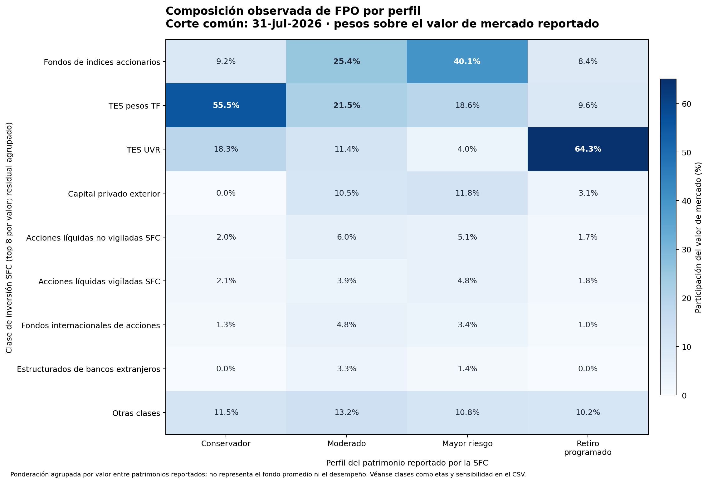

# Asignación observada de fondos de pensiones obligatorias

## Pregunta de negocio

¿Cómo se distribuye el valor reportado de las inversiones entre clases de activos para los perfiles de riesgo de pensiones obligatorias? Este companion toma un corte común de la composición informada a la Superintendencia Financiera de Colombia (SFC) y convierte los valores de mercado en pesos de exposición por perfil y clase. Sirve como contexto observable para una revisión humana de asignación y como comprobación de una transformación dato→pesos.

El cálculo no valida una frontera eficiente, Black–Litterman, rendimientos esperados, covarianzas, alpha, idoneidad para un afiliado ni la rentabilidad futura. El laboratorio sintético de optimización permanece intacto y separado.

## Fuente y cobertura

La fuente es el conjunto oficial [Formato 351 — Composición del portafolio de inversiones](https://www.datos.gov.co/Hacienda-y-Cr-dito-P-blico/Formato-351-Composici-n-del-portafolio-de-inversio/ur2p-h4yf), enlazado por la SFC en su sección de [portafolios de inversión detallados](https://www.superfinanciera.gov.co/publicaciones/10114986/portafolio-de-inversion-detallado-2023/). La SFC describe esos archivos como inversiones de los fondos moderado, mayor riesgo, conservador y retiro programado. La publicación agrupa la composición en clases regulatorias; no es una serie de rendimientos.

El archivo de entrada de este corte ya era un resultado de consulta agregado: `fecha_de_corte × nombre_patrimonio × descripcion_clase_inversion`, 26.155 filas entre enero de 2023 y julio de 2026, 43 cortes y 56 clases. La consulta sumó `valor_mercado_o_pres_pesos` por grano y contó títulos; la definición de extracción está documentada en `data/source_reference.json`. El companion emplea `valor_mercado` en COP y el nombre del patrimonio para agrupar por perfil.

**Vintage.** El snapshot se descargó el 11 de octubre de 2026, pero su observación máxima es el **31 de julio de 2026**. Por tanto, representa ese corte histórico y no el portafolio vigente al momento de consulta. Se eligió la fecha común más reciente para los cuatro perfiles; el corte contiene 15 nombres de patrimonio observados: 4 conservadores, 3 moderados, 4 de mayor riesgo y 4 de retiro programado.

**Uso y derechos.** La SFC autoriza la reutilización, transformación y divulgación de sus datos abiertos bajo su [licencia abierta](https://www.superfinanciera.gov.co/publicaciones/10116019/licencia-abierta-y-condiciones-de-uso-para-datos-abiertos/); el [portal nacional de Datos Abiertos](https://herramientas.datos.gov.co/terminos) publica las condiciones de uso. Se mantiene atribución a SFC y dataset `ur2p-h4yf`. El CSV de entrada no se copia a este proyecto; se conserva solo la referencia, query y SHA-256.

## Método y lectura

Los perfiles se asignan por coincidencia textual del nombre del patrimonio con `CONSERVADOR`, `MODERADO`, `MAYOR RIESGO` o `RETIRO PROGRAMADO`, siempre dentro de nombres que comienzan con `FONDO DE PENSIONES`. No se infiere ni normaliza la administradora detrás de nombres genéricos. Para cada perfil, el peso de la clase es:

```text
peso_clase = suma(valor_mercado en COP para la clase y el perfil)
             / suma(valor_mercado en COP para todas las clases del perfil)
```

La figura muestra las ocho clases con mayor valor total agregado entre perfiles y agrupa el remanente como “Otras clases”. La tabla derivada conserva las 56 categorías SFC y añade una sensibilidad: mediana de los pesos por nombre de patrimonio, asignando cero a una clase sin fila de inversión observada. La estimación principal pondera por valor; la mediana da el mismo peso a cada nombre de patrimonio. La diferencia es deliberada: el total ponderado describe la asignación de capital reportada para el perfil, mientras la mediana resume nombres de patrimonio sin ponderarlos por tamaño.



En el corte común, TES pesos representa **55,5%** del valor agregado del perfil conservador y TES UVR **64,3%** del de retiro programado. En mayor riesgo, los fondos representativos de índices accionarios son **40,1%**; en moderado, **25,4%**. Son participaciones contables de esta clasificación y fecha, no estimaciones de riesgo económico, garantía de liquidez o recomendación de asignación.

## Calidad del dato y límites

- El runner valida SHA-256, esquema, campos no vacíos, valores numéricos finitos, llave única `fecha × patrimonio × clase`, número de filas y fechas del snapshot.
- La población seleccionada para 2026-07-31 contiene 456 filas y 56 clases. En esa población no hay valores de mercado negativos y hay una fila con valor cero; el cero se conserva y no afecta la suma. Esta comprobación aplica al corte seleccionado, no a toda serie histórica ni a otros fondos.
- Los nombres de patrimonio no son un registro normalizado de entidades administradoras. El análisis informa el número de nombres por perfil y no presenta el corte como una cobertura completa de administradoras.
- La composición por clase no permite reconstruir exposiciones look-through de fondos colectivos, duración de tasa, riesgo de crédito, divisa, liquidez, garantías, apalancamiento ni resultados de afiliados.
- Una observación de portafolio es un stock en una fecha, no un retorno. No se deriva performance, volatilidad, covarianza ni causalidad desde estas participaciones.
- El HHI por clase disponible en el resumen mide concentración dentro de esta taxonomía; no es una medida completa de diversificación por factor de riesgo.
- El snapshot termina en julio pese a haberse extraído en octubre; cualquier lectura temporal debe refrescar la consulta y congelar un nuevo vintage antes de llamarse actual.

## Reproducción

Desde este directorio, con Python, NumPy y Matplotlib instalados, indica la ruta externa al snapshot exacto. El proyecto no descarga ni duplica el archivo fuente:

```bash
python3 official_companion.py --source-csv "/ruta/externa/sfc_pensiones_portafolio_mensual.csv"
```

El runner compara SHA-256 con `data/source_reference.json` antes de procesar. Si la fuente se actualiza, debe guardarse fuera de este proyecto, registrar su hash, corte, query y grano, y revisar los supuestos de selección antes de cambiar la referencia.

Resultados generados:

- `reports/observed_allocation_by_profile.csv` — pesos por clase y perfil, además de la sensibilidad por mediana de patrimonio;
- `reports/observed_allocation_summary.json` — fuente, vintage, cobertura, composición y concentración descriptiva;
- `reports/observed_allocation_heatmap.png` — visualización de clases principales.

## Referencias institucionales

- [Dataset oficial Formato 351 en Datos Abiertos](https://www.datos.gov.co/Hacienda-y-Cr-dito-P-blico/Formato-351-Composici-n-del-portafolio-de-inversio/ur2p-h4yf)
- [Portafolio de inversión detallado — SFC](https://www.superfinanciera.gov.co/publicaciones/10114986/portafolio-de-inversion-detallado-2023/)
- [Licencia abierta de la SFC](https://www.superfinanciera.gov.co/publicaciones/10116019/licencia-abierta-y-condiciones-de-uso-para-datos-abiertos/)
