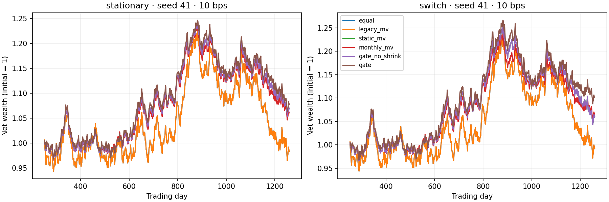

# Informe · Rebalanceo por beneficio frente a costo

Fecha local: 2026-10-12, America/Bogota. Base auditada: `558bde13013df8a446fbb6acf4c69447be88dd03`.

## 1. MVP y auditoría

Se inspeccionaron README, los cinco main.py de asset-management, historial Git,
CMakeLists y el header compartido include/quant/risk.hpp. No se encontró este
filtro ni una verificación de optimalidad en asset-management. Esto no demuestra
que no exista en otras ramas o en literatura. Se conserva el proyecto original;
la nueva subcarpeta añade verificación y benchmark al backtest funcional.

## 2. Pregunta, brecha e hipótesis

¿Puede una regla transparente reducir negociación innecesaria sin ocultar errores
de optimización? El solver histórico aplica tolerancias absolutas a covarianzas
diarias del orden de 1e-4 y devuelve pesos iguales en el caso base, sin validar
convergencia. La contribución incremental es corregirlo con escala normalizada,
gradiente y certificado convexo, y aislar el efecto de un filtro de costos.

H1 primaria: gate_no_shrink tiene menor rotación media que monthly_mv a 10 bps.
H2 secundaria: mejor Sharpe medio pareado; un intervalo que incluye cero deja H2
inconclusa. No se exige un resultado favorable para cerrar el experimento.
El shrinkage diagonal 20% es una ablation separada, no una innovación.

## 3. Prior art real

- Markowitz (1952), DOI 10.1111/j.1540-6261.1952.tb01525.x: formulación media-varianza.
- DeMiguel, Garlappi y Uppal (2009), DOI 10.1093/rfs/hhm075, SSRN 1376199: benchmark 1/N y error de estimación.
- Boyd et al. (2017), arXiv 1705.00109, q-fin.PM: optimización que combina riesgo, costos y retornos; no replicamos su controlador multiperíodo.
- Hautsch y Voigt (2019), arXiv 1709.06296 y DOI 10.1016/j.jeconom.2019.04.028: costos y regularización de la asignación.
- Chen et al. (2020), arXiv 2001.01612: costos cuadráticos; aquí sólo hay costos proporcionales.
- Leung y Li (2014/2015), arXiv 1411.5062, q-fin.TR: tiempos óptimos con costos en un spread OU; no es el modelo de este MVP.
- Das, Halder y Dey (2017), arXiv 1404.3258, q-fin.ST: regularización bayesiana; aquí el shrinkage es diagonal fijo.
- Roxanas (2026, v2), arXiv 2512.22109, q-fin.CP: mantenimiento de index trackers con baja rotación; objetivo distinto de mínima varianza.

Se consultó también arXiv 2504.08843 (q-fin.RM), cuyo enfoque de quantum annealing
no se implementa. La búsqueda incluyó las cinco categorías solicitadas y SSRN.
Búsquedas dirigidas en Semantic Scholar y Papers with Code no devolvieron una
fuente primaria utilizable sobre esta regla en esta sesión; no se afirma ausencia
de literatura. No se obtuvo acceso a sus índices completos ni revisión sistemática
exhaustiva de las revistas listadas. Evidencia bibliográfica basada en páginas de
arXiv, publisher y SSRN recuperadas; no se declara lectura íntegra de todos los papers.
No se compara rendimiento financiero de sus estudios con simulaciones propias:
mercados, universos y periodos distintos harían esa comparación injusta.

## 4. Diseño y config

Config fijada antes de ejecutar: 5 activos, 1260 días, ventana 252, rebalanceo 21,
gamma 5, shrinkage diagonal .2, seeds 41--60. Dos regímenes: estacionario y
cambio de volatilidades (orden invertido) en día 630. Medias anuales
[.08,.07,.04,.05,.06]; vol [ .18,.15,.08,.10,.20 ]; correlación PSD generada
con A@A.T, A uniforme [-.2,.6], exactamente como el DGP histórico.
Retornos gaussianos diarios; no hay shocks de liquidez ni selección de activos.
La regla utiliza utilidad de riesgo y omite medias: activo con retorno esperado
más alto no recibe premio explícito. Heterogeneidad de medias se conserva como
fuente de posible fallo. Todas las estrategias ven las mismas trayectorias.

6 estrategias x 20 seeds x 2 regímenes x 3 costos (0/10/50 bps) = 720 corridas.
static_mv estima una sola vez en los primeros 252 días y luego buy-and-hold.
monthly_mv usa solver corregido. legacy_mv conserva el solver original, aunque
los costos de todas las variantes se armonizan a (1-costo)*(1+retorno bruto)-1. El stdout original
literal se guarda separadamente en legacy_stdout.txt. No se confunden ambos.
rf=0; sum(abs(delta w)) mide compras + ventas; sin factor 1/2. Los costos se
pagan antes de invertir, neto=(1-c)*(1+r). La dotación inicial de pesos iguales
es gratuita para todos, pero el cambio inicial a MV paga costos.

Bootstrap pareado por seeds, 5000 réplicas, seed 20261012; percentiles 2.5/97.5%.
No se remuestrean días ni se calibran hiperparámetros con test. Inferencia describe
sólo incertidumbre Monte Carlo en estos DGP, no rentabilidad futura. No hay ajuste
por múltiples comparaciones; tablas secundarias se consideran exploratorias.

## 5. Implementación

main.py orquesta; src/portfolio.py implementa covarianza, optimización, decisión,
simulación, accounting y métricas. En simplex convexo el gap
w'grad - min(grad) es un certificado de primer orden; se exige <=1e-5 con matriz
normalizada, factibilidad y success de SLSQP. Covarianza PSD/simétrica/finita.
El filtro no resuelve una optimización conjunta con L1: compara candidato MV
contra cartera actual, todo-o-nada; es una heurística miope, no política óptima.

## 6. Tests y benchmarks ejecutados

13 tests pasan: fórmula analítica diagonal; escala 1e-8 a 1e4; 30 matrices PSD
aleatorias de 2/5/10 activos; finitud; factibilidad; conservación de pesos; costos;
no lookahead por perturbación de futuros; costo cero; covarianza singular cero;
entradas inválidas; fallo explícito del solver; drawdown desde riqueza inicial.
Las pruebas generativas usan seed 777, no Hypothesis. Cobertura del motor src:
97.16% combinando statements/branches; no se atribuye cobertura a main.py o al notebook.
Lint Ruff pasa. No se ejecutó un type checker estático; validación de contratos
es dinámica. Se intentó regresión adicional de C++ con ASan/UBSan, pero CMake/ctest
no están instalados: no ejecutada, no se inventan resultados. No hay cambios C++,
por lo que se reduce el alcance a Python. Dockerfile presente, no construido.
La CI general de notebooks falló al instalar contourpy==1.4.0 con Python 3.11;
se actualizó el workflow a Python 3.12, compatible con ese pin.
Notebook: cuatro celdas de código realmente ejecutadas con IPython en proceso,
con tablas/figura visibles. El kernel TCP de nbclient falla por restricciones de
sockets; no se simulan outputs. Se usa captura real de rich display y stdout.

Tiempo benchmark: 30.258 s; Python 3.12.14, NumPy 2.3.5, SciPy 1.17.0, pandas 2.2.3. CPU: AMD EPYC 9V74 80-Core Processor. OS: Linux-6.18.44-x86_64-with-glibc2.39. Tiempo de wall clock con carga compartida; una medición, no latencia de producción.

| days | assets | seconds | python_peak_bytes |
|---|---|---|---|
| 630.000000 | 5.000000 | 0.161675 | 138978.000000 |
| 1260.000000 | 5.000000 | 0.408077 | 366733.000000 |
| 2520.000000 | 5.000000 | 1.050949 | 817929.000000 |

Memoria medida con tracemalloc: pico de asignaciones Python del backtest, excluye datos previamente generados y memoria nativa no rastreada; NO es RSS. Escalabilidad sólo en días, no número de activos.

## 7. Resultados

Medias de 20 seeds; costos 10 bps:

| regime | strategy | annual_return | volatility | sharpe | max_drawdown | turnover | cost_drag_bps |
|---|---|---|---|---|---|---|---|
| stationary | equal | 0.058483 | 0.102424 | 0.603336 | -0.170516 | 1.118137 | 11.181367 |
| stationary | gate | 0.057573 | 0.080292 | 0.699799 | -0.127291 | 0.766538 | 7.665384 |
| stationary | gate_no_shrink | 0.055396 | 0.074653 | 0.715289 | -0.116293 | 0.999518 | 9.995175 |
| stationary | legacy_mv | 0.058483 | 0.102424 | 0.603336 | -0.170516 | 1.118137 | 11.181367 |
| stationary | monthly_mv | 0.048112 | 0.069151 | 0.705245 | -0.110020 | 3.180119 | 31.801191 |
| stationary | static_mv | 0.047899 | 0.069579 | 0.691927 | -0.109479 | 1.079920 | 10.799204 |
| switch | equal | 0.058007 | 0.102076 | 0.595153 | -0.170340 | 1.115462 | 11.154620 |
| switch | gate | 0.055217 | 0.082776 | 0.651938 | -0.133373 | 0.840911 | 8.409111 |
| switch | gate_no_shrink | 0.054196 | 0.077885 | 0.674795 | -0.124198 | 1.018082 | 10.180816 |
| switch | legacy_mv | 0.058007 | 0.102076 | 0.595153 | -0.170340 | 1.115462 | 11.154620 |
| switch | monthly_mv | 0.048623 | 0.069868 | 0.707832 | -0.108664 | 3.245447 | 32.454467 |
| switch | static_mv | 0.048288 | 0.075129 | 0.638385 | -0.119297 | 1.079920 | 10.799204 |



La figura es una trayectoria ilustrativa, no seleccionada por mejor resultado; equal y legacy_mv se superponen.

Diferencias pareadas de gate (con shrinkage) en Sharpe:

| regime | baseline | mean_delta | low | high | positive_fraction |
|---|---|---|---|---|---|
| stationary | equal | 0.096463 | 0.025941 | 0.172870 | 0.650000 |
| stationary | monthly_mv | -0.005445 | -0.087952 | 0.071198 | 0.500000 |
| stationary | gate_no_shrink | -0.015490 | -0.057315 | 0.025461 | 0.400000 |
| switch | equal | 0.056785 | -0.025907 | 0.147108 | 0.550000 |
| switch | monthly_mv | -0.055894 | -0.156064 | 0.038363 | 0.400000 |
| switch | gate_no_shrink | -0.022857 | -0.066019 | 0.018329 | 0.400000 |

## 8. Diagnóstico y fallos

En primera ventana del DGP original seed 41: legacy=[.2,.2,.2,.2,.2], varianza
5.716431e-5; corregido≈[0,0,.839593,.160407,0], varianza 2.479242e-5.
Reducción in-sample 56.63%, gap diario 6.78e-21 frente a 6.45e-5.
Es corrección numérica, no reducción garantizada de riesgo fuera de muestra.
El stdout original muestra Sharpe 0.87 tanto iguales como MV: el solver no
identifica una cartera distinta en esa ejecución. repo_dgp.csv incluye diez años
con la convención común de costos y todos los baselines.

H1 apoyada en el experimento: gate_no_shrink reduce rotación ~68.6% contra
monthly_mv a 10 bps en ambos regímenes. gate con shrinkage reduce ~75.9% y ~74.1%.
H2 no demostrada para gate: diferencias de Sharpe frente a monthly_mv son
-0.00545 estacionario y -0.05589 con cambio; ambos intervalos contienen cero.
Ablation negativa: shrinkage reduce Sharpe vs gate_no_shrink ~0.0155/0.0229;
reduce rotación a costa de mayor volatilidad. Mayor riqueza terminal media no
implica dominancia de Sharpe. El filtro demora adaptación a covarianzas cambiantes.
A costo cero gate_no_shrink coincide numéricamente con monthly_mv en test.
No se elimina ningún seed ni se cambian parámetros después de observar resultados.

## 9. Limitaciones y riesgos

M2, prototipo verificado sintético; no producto listo para producción ni validación
con mercado. DGP gaussianos, cinco activos, sólo veinte seeds, medias conocidas
por simulador pero no por regla, sin cambios de correlación, retornos extremos,
spread dinámico, market impact, límites de liquidez, impuestos, dividendos,
missing data, supervivencia ni selección temporal de universo. Long-only puede
concentrarse en uno/dos activos; no hay cap por activo ni exposición sectorial.
La normalización y certificado no validan la estimación de covarianza ni el modelo.
Horizon fijo y gamma arbitrario; no una utilidad calibrada a inversionista real.
No hay validación independiente, seguridad, logging operativo ni integración broker.
Los motores credit/market/liquidity C++ del repo siguen siendo prototipos y aquí
no avanzan de estado. Tests y outputs no prueban rentabilidad realizable.

## 10. Reproducir

Desde raíz del repo:

```bash
bash 04-quant-strategy-and-products/asset-management/rebalanceo-beneficio-costo/reproduce.sh
```

Reproduce script instala requirements en .venv, ejecuta Ruff, pytest con cobertura,
benchmark y notebook. Figura inspeccionada visualmente; tamaños/hardware registrados.
La reproducción puede variar en tiempos, memoria, solver al cambiar BLAS/hardware;
el conjunto numérico principal es determinista para config/seeds fijadas.
C++ (si se instala CMake, ejemplo de regresión del repo, NO nuevo MVP):

```bash
cmake -S 04-quant-strategy-and-products/risk-engines -B build/quant -DCMAKE_BUILD_TYPE=Debug
cmake --build build/quant --parallel
ctest --test-dir build/quant --output-on-failure
./build/quant/credit_risk 100000
./build/quant/market_risk 100000
./build/quant/liquidity_risk 100000
```

## 11. Referencias BibTeX

Ocho entradas reales en [referencias.bib](referencias.bib), con DOI/arXiv/URL.
No se reivindica revisión exhaustiva ni novedad científica mundial.

## 12. Rúbrica autoevaluada (1--5)

| Novedad | Rigor | Reproducibilidad | Código | Claridad | Impacto | Honestidad | MVP completo/ejecutable |
|---|---|---|---|---|---|---|---|
| 2 | 4 | 4 | 4 | 4 | 3 | 5 | 5 |

Novedad local; rigor limitado al DGP; reproducibilidad con dependencia de wheels
externos y contenedor sin build; impacto es fiabilidad de investigación, no alfa.

## 13. Checklist de cierre

- [x] Código real modular src/ y main.py.
- [x] Comando único que instala y corre.
- [x] Tests automatizados pasando.
- [x] Baselines comparados con números.
- [x] CSV/JSON y figura verificables.
- [x] README.md, informe.md, referencias.bib y MVP.md.
- [x] Subcarpeta asset-management/rebalanceo-beneficio-costo.
- [x] Declaración explícita de prototipo, no producción.

Siguiente iteración recomendada: validar la corrección sobre datos abiertos reales,
con tres tareas concretas:
1. asset-management: incorporar precios ajustados abiertos y universo con fechas de disponibilidad.
2. asset-management: evaluar gamma/shrinkage con validación walk-forward anidada y colas pesadas.
3. risk-engines: instalar toolchain y correr ctest + ASan/UBSan + validación fuera de muestra del motor de mercado.
