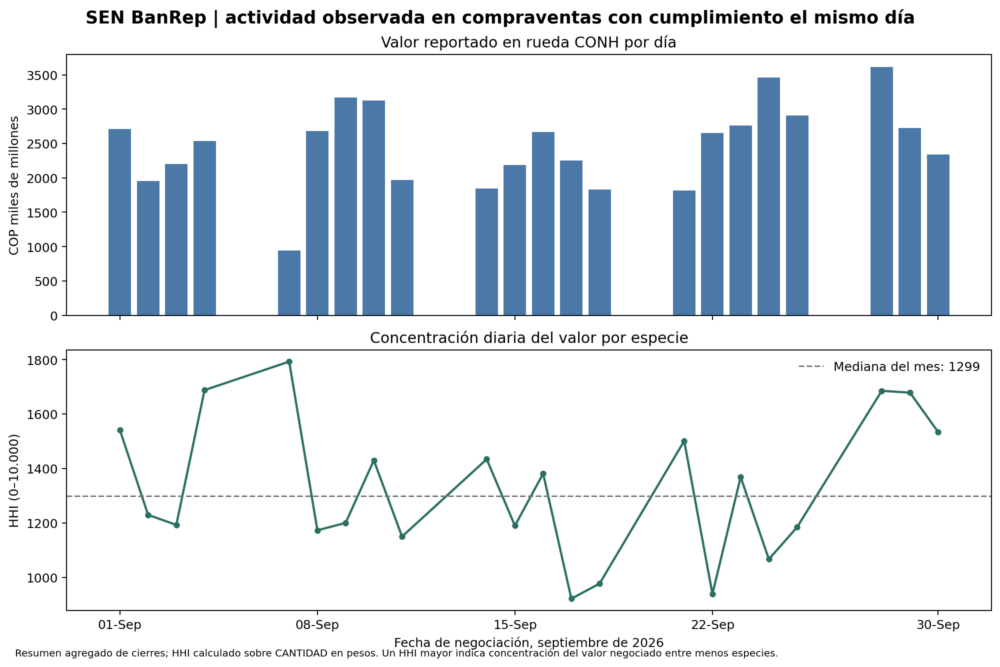

# Actividad y concentración de compraventas SEN

## Pregunta de negocio

Un gestor o equipo de tesorería necesita distinguir entre un cambio en el valor operado y un cambio en la concentración de los títulos negociados. Este companion convierte el resumen mensual de cierres del Sistema Electrónico de Negociación (SEN) en una vista diaria de actividad y concentración para la rueda de compraventas con cumplimiento el mismo día (CONH). La vista sirve para orientar una revisión humana de la concentración observada por especie en el mercado de contado.

## Fuente, grano y derechos de uso

La fuente es el archivo original de septiembre de 2026 publicado por el Banco de la República: [Resumen histórico de cierres del SEN](https://www.banrep.gov.co/es/sistemas-pago/sen/resumen-cierres), [ZIP oficial](https://www.banrep.gov.co/sites/default/files/sen-resumencierresseptiembre2026.zip). Se consultó el 10 de noviembre de 2026. BanRep define el resumen como estadísticas de transacciones del mes inmediatamente anterior y enumera fecha, especie, rueda, plazos, volumen, cantidad en pesos, número de cierres y precios/equivalencias.

El libro tiene una hoja y 1.294 filas observacionales, con grano `fecha × especie × rueda × plazo ida × plazo vuelta`. La llave de ese grano no presenta duplicados en el snapshot. Incluye 22 fechas observadas, del 1 al 30 de septiembre, y las ruedas SIML y CONH. La guía de BanRep define CONH como compraventa con cumplimiento el mismo día; este companion excluye SIML para no mezclar simultáneas con compraventas de contado.

El [aviso legal de BanRep](https://www.banrep.gov.co/es/transparencia/aviso-legal) permite reproducir información económica estadística publicada, siempre que no se altere el contenido original y se indique la fuente y fecha de consulta; excluye datos económicos de proveedores externos. El raw canónico permanece en Master_DATOS y no se duplica en este producto. Las series agregadas en `reports/` son transformaciones propias y se presentan como tales, sin atribuirles carácter de estadística oficial publicada por BanRep. No se incluyen identificadores de contrapartes ni datos de clientes.

## Método y decisión admisible

Se filtra `RUEDA = CONH`; cada fila ya agrega cierres para una especie, fecha y combinación de plazos. Para cada fecha se suma `CANTIDAD` (pesos, según la descripción del reporte) por especie y se calcula:

```text
share_especie = cantidad_en_pesos_especie / cantidad_en_pesos_total_del_día
HHI_diario = 10.000 × Σ share_especie²
especies_efectivas = 10.000 / HHI_diario
```

Así el denominador es el valor negociado reportado en pesos en CONH ese día; HHI mayor significa que el valor de ese día se distribuyó entre menos especies. Se conserva además el valor diario total en COP. No se fijan umbrales de alerta porque un solo mes no permite calibrarlos.

En este snapshot hay 547 filas CONH agregadas a 22 fechas. El total observado en septiembre es COP 54,34 billones; la mediana diaria es COP 2.594,9 miles de millones. El HHI diario mediano es 1.299 (mínimo 922; máximo 1.792), equivalente a unas 7,7 especies efectivas en la fecha mediana. Para el 30 de septiembre, el HHI es 1.534. Son descripciones de la distribución de actividad reportada en este mes, no un cambio de régimen ni una recomendación de inversión.



**Decisión admisible:** usar la figura para priorizar conversación sobre concentración observada en especies y validar si el universo analizado representa el mercado que interesa. No usar el indicador para aprobar una operación, estimar el costo de liquidación o afirmar que un portafolio puede venderse en los mismos montos.

## Trade-offs, sesgos y límites

- **`CANTIDAD` en vez de `VOLUMEN`:** la ficha de BanRep nombra ambos campos por separado y describe cantidad en pesos; por eso los pesos definen la ponderación económica. No se interpreta volumen como dinero.
- **Solo CONH:** produce una medida más coherente de compraventa contado con liquidación el mismo día. Excluye SIML, CTM0, otras ruedas/mecanismos y cualquier actividad externa al SEN; por ello no representa el mercado secundario total de TES.
- **Resumen de cierres, no cinta de transacciones:** las filas agregan cierres por especie, rueda y plazos. No hay identificador individual de operación, hora, lado, profundidad del libro ni cotizaciones simultáneas. No se pueden estimar spread, impacto, latencia, prioridad de cola o costo ejecutable.
- **Una sola mensualidad:** no permite comparar regímenes, estacionalidad, persistencia ni alertas estadísticas. El HHI es una medida de concentración de actividad, no de liquidez disponible o riesgo de concentración de una cartera.
- **Representatividad:** la actividad de una especie en SEN no informa quién la negoció, la posición neta de inversionistas ni el monto que estaría disponible a un precio dado. No se atribuye causalidad a eventos ni performance.

## Snapshot y reproducción

El raw canónico procede de `Master_DATOS/04_SHADOW_RISK/01_RAW/banrep_sen_resumen_cierres_2026-09.zip` ([Drive ID](https://drive.google.com/file/d/1MTGnmDemBMinnLags7jnvJhpMjS4F_fZ/view): `1MTGnmDemBMinnLags7jnvJhpMjS4F_fZ`). El manifiesto canónico es `Master_DATOS/04_SHADOW_RISK/02_PROCESSED/liquidez_sen.manifest.json` (Drive ID `1Whh-iLj8Iwt_aSYKaUpCJy01f51bNf1V`). SHA-256 esperado:

```text
4d21cf3193331340da312cb67b07a6192234d131317089d4ab54048b217acae5
```

El manifiesto de Drive registra fuente BanRep, corte 2026-09-30, 1.294 filas e ingesta del 10 de octubre de 2026. La publicación mensual de octubre está disponible posteriormente en el portal; este companion mantiene deliberadamente el vintage congelado de septiembre para ser consistente con el manifiesto y el hash registrado. `data/source_reference.json` conserva URL, IDs de Drive, tamaño y checksum; no contiene el raw.

Desde este directorio, con Python, `openpyxl` y `matplotlib` instalados, se puede reproducir desde un archivo de staging externo (por ejemplo, descargado desde el Drive canónico):

```bash
python3 official_companion.py --source-zip /ruta/externa/banrep_sen_resumen_cierres_2026-09.zip
```

También se puede solicitar explícitamente la descarga del archivo oficial (requiere acceso de red):

```bash
python3 official_companion.py --download-source
```

El runner no descarga ni copia el raw por defecto. En ambos modos verifica SHA-256 contra la referencia de Drive, archivo/hoja, encabezados, grano único, rangos básicos, corte y tamaño de la población antes de guardar:

- `reports/sen_conh_daily_concentration.csv` — valores diarios agregados derivados;
- `reports/sen_conh_summary.json` — metodología, vintage, cifras y alcance;
- `reports/sen_conh_concentration.png` — evidencia visual.

## Referencias institucionales

- [Resumen de cierres SEN (archivo histórico y publicaciones mensuales)](https://www.banrep.gov.co/es/sistemas-pago/sen/resumen-cierres)
- [Archivo mensual original de septiembre de 2026](https://www.banrep.gov.co/sites/default/files/sen-resumencierresseptiembre2026.zip)
- [FAQ: rueda CONH y horarios del SEN](https://www.banrep.gov.co/es/preguntas-frecuentes/sen-horario-de-operacion)
- [Aviso legal del Banco de la República](https://www.banrep.gov.co/es/transparencia/aviso-legal)
