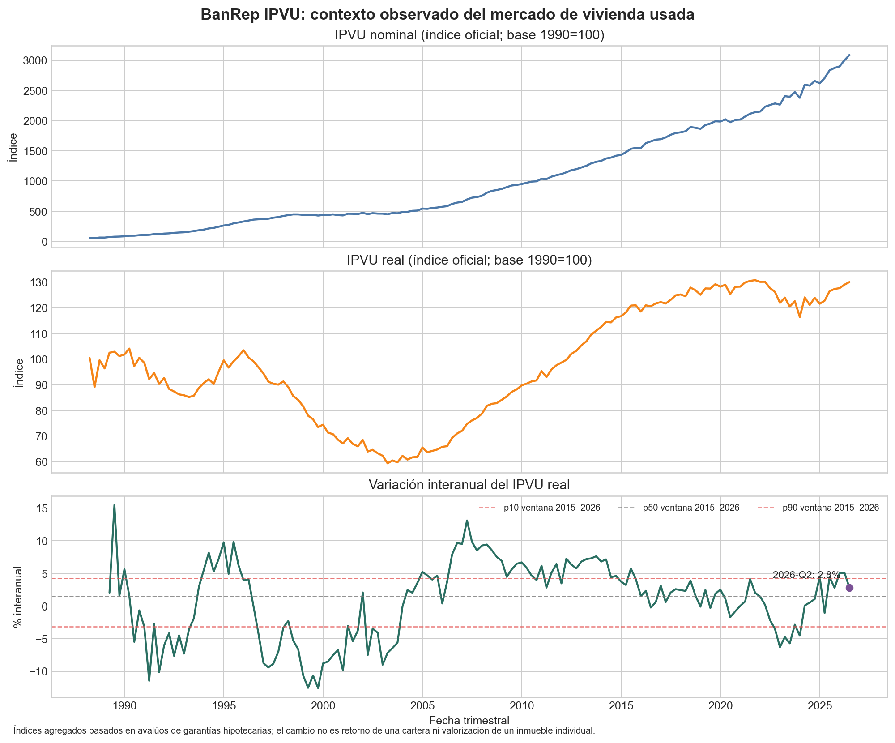

# Companion de mercado observado: IPVU de BanRep

El problema de decisión es cómo dar contexto al análisis de vivienda usada cuando todavía no se dispone de comparables transaccionales para una ciudad o activo particular. Este companion reproduce la serie nacional del Índice de Precios de Vivienda Usada (IPVU) del Banco de la República y resume la variación interanual del índice real. Puede servir para enmarcar escenarios de mercado y priorizar una revisión humana de supuestos de precio o colateral. No estima el valor de una vivienda, no valida un modelo de avalúo y no mide el rendimiento de una inversión ni el desempeño de créditos hipotecarios.

La fuente son las series trimestrales oficiales nominal y real del [IPVU en BanRep](https://suameca.banrep.gov.co/estadisticas-economicas/informacionSerie/100004/indice_precios_vivienda_usada_ipvu/), extraídas el 10 de noviembre de 2026 con el servicio oficial consulta de información de serie (`consultaInformacionSerieXTipoDato?idSerie=57&tipoDato=0&cantDatos=300`). El corte publicado es 2026-Q2; la ficha indica última carga el 23 de octubre de 2026. Las dos series tienen 154 observaciones trimestrales, del primer trimestre de 1988 al segundo trimestre de 2026, y están expresadas como índices (base 1990=100), no como precios en pesos. El IPVU se construye con avalúos de garantías hipotecarias reportados por seis entidades financieras y cubre ciudades principales y algunos municipios cercanos; consulte la [metodología oficial](https://www.banrep.gov.co/sites/default/files/METODOLOGIA_IPVU.pdf).

**Proxy y cálculo.** Se calcula `100 × (IPVU real_t / IPVU real_t−4 − 1)`, una variación interanual que evita comparar niveles nominales entre años. Para el contexto de escenarios se reportan percentiles 10, 50 y 90 de esa tasa en 2015-Q1–2026-Q2 (46 observaciones con rezago disponible); una ventana 2010-Q1–2026-Q2 es sensibilidad. En la ventana principal, la última variación (2026-Q2) es **2,83%**; p10/mediana/p90 son **−3,18% / 1,50% / 4,28%**. Son referencias descriptivas de esta muestra histórica, no límites de estrés ni pronósticos.



**Trade-off.** Se usa el índice real agregado para describir el cambio del mercado, en lugar del nominal, porque la inflación distorsiona comparaciones de niveles entre periodos. Se conserva el índice nominal para lectura contextual y control. Se usa una variación interanual y no trimestral para reducir la estacionalidad de frecuencia, a costa de suavizar giros recientes. El agregado nacional facilita reproducción y evita atribuir detalle geográfico que la serie descargada no ofrece en esta forma.

**Sesgos y límites de uso.** El IPVU representa viviendas usadas que respaldaron préstamos en las entidades informantes; la composición de esas garantías puede diferir de las viviendas transadas, listadas o de una cartera concreta. La cobertura geográfica y de entidades puede cambiar a lo largo de la historia. Por ello, el proxy no prueba la trayectoria de un inmueble individual, su liquidez, el valor realizable de una garantía ni el riesgo de pérdida dado incumplimiento. Solo puede ayudar a contextualizar o priorizar discusión de escenarios; no debe activar límites automáticos ni sustituir comparables locales, avalúo independiente o revisión humana. No se infiere causalidad ni desempeño predictivo.

**Snapshot, integridad y reproducción.** Se preservan las respuestas originales en `data/`. SHA-256 nominal: `2685543dd6ca23680aacd736cfb5078c163b36eda763b6b1708ff61a23de0ec4`; real: `46d19dfcceac2ad0107cc0167809bd80be99089273615e784716d185d7ba0311`. El runner verifica ambas huellas, los identificadores 56/57, calendario común y corte antes de producir CSV, resumen y figura. La consulta oficial de archivo de serie (`consultaSerieArchivo?idSerie=56` y `...idSerie=57`) respondió `false`, así que no se pudo obtener el Excel por esa ruta. Los valores numéricos se congelaron desde el endpoint oficial de observaciones; no se reemplazaron con scraping de terceros.

Desde este directorio, con Python, pandas y matplotlib instalados:

```bash
python3 official_ipvu_companion.py
```

Artefactos: `reports/ipvu_quarterly_derived.csv`, `reports/ipvu_summary.json` y `reports/ipvu_market_context.png`. Para sustituir el snapshot por una publicación posterior, se deben conservar los archivos originales, registrar la fecha de consulta y actualizar deliberadamente hashes y corte esperado en el runner.


[Volver al área](../README.md)
