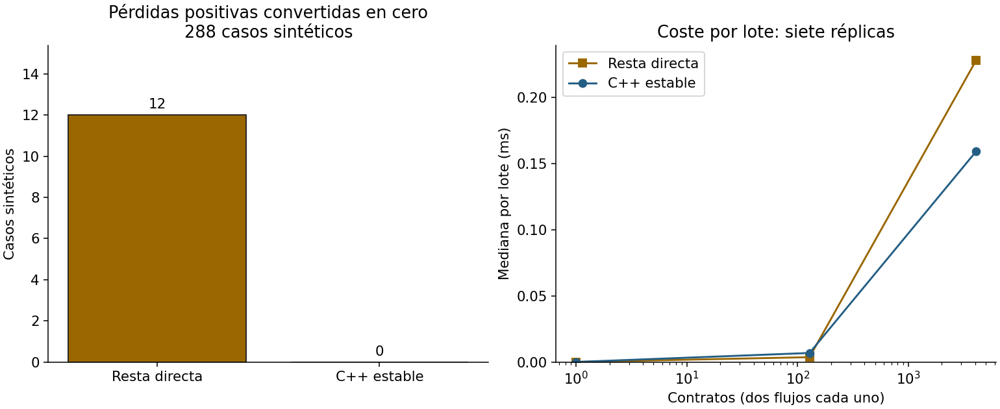

# MVP 2026-10-20 — contrato Stage 3 Python/C++

## Pregunta, brecha e hipótesis

¿Se puede transferir el núcleo de cash shortfall ya validado en Python a una
API C++17 independiente sin perder la pérdida de demora pequeña? Hipótesis:
error relativo frente a Decimal y discrepancia frente al Python real <=1e-12
en el dominio fijado; ningún resultado positivo perdido a cero en esta rejilla.

Revisada base dd5dc42984ca98ecf3ccda47a21dfd4008afe0bb. PR57 ya integrado.
El motor C++ de crédito simula default futuro; no es una ruta Stage3. El núcleo
Python ya existe: no se repite como investigación nueva. Se añade port acotado,
fixtures compartidas, regresión interlenguaje, sanitizers y mediciones. No se
modifica el simulador gaussiano ni el motor IFRS9 general.

## Prior art

IFRIC marzo2019 describe déficits de efectivo descontados; BIS d350 contextualiza
gobierno del riesgo de crédito y pérdidas esperadas. Reitgruber arXiv1411.4265
discute problemas metodológicos de ECL/LGD. NumPy documenta expm1 estable cerca
de cero; Python Decimal permite referencia de alta precisión. GCC documenta
sanitizers/cobertura y NIST separa reproducibilidad de precisión.
Siete entradas reales en referencias.bib y búsqueda/accesos en
benchmarks/prior-art.md. No se afirma novedad matemática ni lectura exhaustiva
de SSRN, ECB, Journal of Risk o Journal of Financial Econometrics.

## Método y supuestos financieros

Activo no POCI ya deteriorado; G importe bruto al cierre, flujos C esperados
netos de recuperación y EIR original r suministrados, no estimados. Sin PD de
nuevo default. Dominio finito no negativo y suma nominal C <= G. Tasas negativas
y surplus se rechazan explícitamente en este MVP. No hay moneda, cartera real
ni régimen de mercado inferido. No son escenarios predictivos de crisis.

En este dominio, G-PV = (G-sumaC)+suma(C*(-expm1(-log1p(r)*t))). La resta directa
se conserva como ablación aritmética, no como competidor económicamente distinto.
El Python del repo es baseline correcto de paridad. Oráculo independiente:
resta directa de VP en Decimal100, preservando exactamente los inputs binary64.
No reutiliza la misma descomposición estable como oráculo.

## Diseño fijado y procedencia

- 288 fixtures: G en 1/100/1e6, r en 0/1e-18/1e-14/.01/.1/1,
  recuperación total en 0/.25/.5/1 de G, dos flujos iguales a tiempos
  t y t+1, t en 0/.5/2/30. No se eliminaron ceros.
- Pruebas generativas:1000 casos con seed20261020, verificando límites,
  monotonicidad en demora y división de un flujo al mismo tiempo.
- Otros casos: shapes inválidos, NaN/Inf/negativos, exceso de recuperación,
  tasa cero, recuperación inmediata, extremos finitos y entradas CLI incompletas.
- Rendimiento: n1/128/4096, dos flujos por contrato,100 lotes por muestra,
  warmup previo, siete réplicas, orden de métodos aleatorizado:42 filas.
  Checksum volatile evita eliminar cálculo; generación e IO fuera del timer.
  Ambos reciben las mismas recuperaciones generadas por seed por réplica.
- Python3.12.14, GCC13.3.0, Linux6.18.55 x86_64/glibc2.39,
  Intel Xeon Platinum8573C. Sin afinidad/frecuencia de CPU bloqueadas.
- Hash del Python real ccf81b0af816fce6cdfd4c36f8f32a9c5d6c839144d42562737f5ef067d068b4;
  fixtures d5397639ce63ca583d4360cbd6d65d5f7dca97abef1bb741b8d8b0f620866ea7.
  La CI vuelve a ejecutar cuando cambia el Python; el hash registra, no impide cambios.

## Resultados ejecutados

| Métrica | Resultado |
|---|---:|
| Fixtures reconciliadas |288 |
| Error relativo máximo C++ vs Decimal100 |2.118802798548048e-16 |
| Diferencia relativa máxima C++ vs Python real |2.47866253148264e-16 |
| Pérdidas positivas perdidas a cero, resta directa |12 |
| Pérdidas positivas perdidas a cero, estable |0 |
| Comprobaciones unitarias/generativas C++ |3023 pasan |
| Fixture CSV bajo ASan/UBSan |idéntico al release |

Ambos criterios <=1e-12 pasan. Los12 ceros de la ablación aparecen con tasa1e-18
y recuperación nominal completa. No se interpreta como frecuencia de fallos
en cartera real ni como materialidad económica.

La tabla completa inputs/outputs está en accuracy.csv. Medianas de tiempo de la
corrida final en summary.json y las42 muestras con RSS en performance.csv.
VmHWM del CLI se conserva por muestra: son picos de proceso, no asignaciones
del algoritmo, y pequeñas diferencias no demuestran ahorro.
Se conservó el primer piloto en pilot.json: para4096 contratos el estable tomó
0.25129324ms frente a0.18408644ms de resta directa. En corridas siguientes cambió
el orden. No se reclama aceleración universal, significancia ni ventaja frente
al pipeline Python completo. El estable además valida inputs, la ablación no;
no es una comparación de APIs con el mismo servicio de validación.

## Fallos observados y correcciones

1. Primera compilación estricta rechazó conversiones implícitas del generador;
   se hicieron explícitas antes de aceptar pruebas.
2. Primer gcov no encontró fuentes por cwd; corregido con rutas de fuente
   absolutas. Se resetea únicamente el contador generado para evitar mezcla de
   perfiles incompatibles. No se ocultan esos avisos como si fueran cobertura válida.
3. wait4 registraba el pico heredado del Python previo al exec, dominando el CLI.
   Ahora se guarda además VmHWM leído dentro del CLI después del exec. No se
   presenta wait4 como asignación del algoritmo; ambos campos quedan explícitos.

## Tests, herramientas y cobertura

CTest nuevo y pruebas legacy del motor central pasan. 3023 comprobaciones en
release y de nuevo ASan/UBSan; los288 casos se ejecutan también bajo sanitizers.
Ruff/formato/mypy del benchmark y clang-format/clang-tidy del C++ pasan.
Warnings Wall/Wextra/Wpedantic/Wconversion tratados como errores. No se usa
GoogleTest/RapidCheck: dependencias evitadas para este contrato pequeño; tests
generativos deterministas incorporados, no fuzzing exhaustivo.

gcov del header stage3.hpp:19/20 líneas (95%), ramas ejecutadas95.45%, tomadas
al menos una vez38/44 (86.36%, incluye arcos generados/excepciones de compilador).
La excepción defensiva de resultado no finito no se alcanzó. No se afirma100%
ni cobertura del CLI, STL o benchmark. Crudo completo en coverage.txt.

ASan/UBSan locales habilitados, leak detection local por defecto desactivada;
la CI la activa explícitamente. Sanitizers no prueban ausencia general de bugs.
No se ejecutó Clang como compilador ni arquitecturas distintas de x86_64.

## Calidad visual y límites

Guía visualize-data aplicada a figura Matplotlib estática: ejes/medidas con
unidades, barras desde0, series por color y marcador. PNG inspeccionado a tamaño
de lectura, sin recortes observados. No se afirma simulación de daltonismo o QA
en pantalla móvil. Es entrega C++ src/CMake; no se requiere notebook adicional.
Referencias compartidas de la guía no disponibles, declarado durante el trabajo.

No se extiende a POCI, stage/SICR, curas, flujos negativos, surplus, tasas negativas,
contabilidad de intereses, gasto/reintegro SFC o calibración de recuperaciones.
La suma simple puede redondear con muchos flujos y la aritmética puede subdesbordar
en otros extremos; no hay garantía universal de precisión, guard de underflow ni
redondeo monetario. El régimen ensayado es una rejilla sintética finita y favorable
al test de cancelación; portabilidad de libm sólo comprobada local/CI observada.
La memoria es pico de proceso con librerías/input, no memoria incremental del
kernel; VmHWM y wait4 tienen límites distintos y no justifican ahorros generales.

## Reproducción, rúbrica y cierre

Desde raíz:
`bash 04-quant-strategy-and-products/risk-engines/stage3-cashflow-audit/run.sh`.
Linux/Python3.12/GCC/gcov y red inicial;18 dependencias fijadas, SO no fijado.
Comando instala, lint/type checks, CMake/CTest/legacy, sanitizers, cobertura y
benchmark. Código real, baseline con números, tests y outputs, README/informe/
MVP/BibTeX, entorno y carpeta correctos: checklist completo. Estado remoto sólo
se informa después de observar CI, no a partir del éxito local.

Rúbrica1–5: novedad3, rigor4, reproducibilidad5, código4, claridad4, impacto3,
honestidad5, MVP completo/ejecutable5. Autoevaluación, no revisión independiente.

Siguiente iteración recomendada: ampliar el contrato y su independencia de plataforma.
1. 04-quant-strategy-and-products/risk-engines: matriz GCC/Clang y fixtures de
   muchos flujos, sumación y tasas extremas con referencia multiprecisión.
2. 03-financial-risk: estimar tiempos/recuperaciones con censura y validación OOT,
   separando incertidumbre estadística del error aritmético.
3. 04-quant-strategy-and-products/risk-engines: añadir escenarios ponderados y
   batch heterogéneo conservando paridad y rechazo explícito de fuera de dominio.
