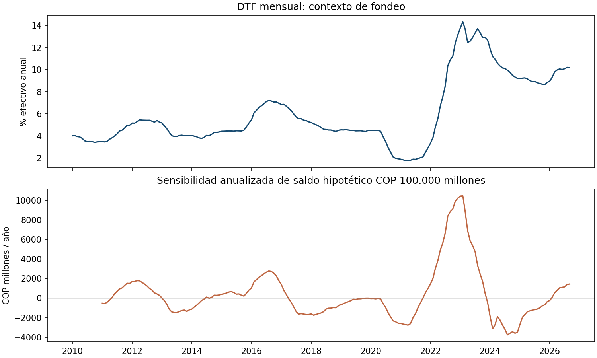

# Aplicación observada: sensibilidad de fondeo a DTF

Un comité de tesorería puede usar cambios históricos de una tasa de referencia para dimensionar escenarios de refinanciación. Esta aplicación toma la DTF mensual del Atlas Económico de Colombia y calcula, para cada mes, el cambio frente a doce meses atrás y su efecto anualizado sobre un saldo **hipotético constante de COP 100.000 millones**. La DTF es la tasa efectiva anual de referencia de captaciones CDT a 90 días; su metodología se describe en [Banco de la República](https://www.banrep.gov.co/es/cual-metodologia-calculo-dtf-y-normativa-relacionada).

La muestra emplea 2010-01 a 2026-09 (201 meses). En septiembre de 2026 la DTF mensual del derivado es 10,20% EA y su cambio interanual es +1,44 puntos porcentuales. Si todo el saldo hipotético se repreciara íntegramente a ese cambio durante un año, la sensibilidad sería **+COP 1.440 millones anualizados**. Es una comparación mecánica entre tasas observadas, no el gasto de una entidad ni un pronóstico.

**Datos y linaje.** El insumo es el derivado [banrep_tasas_mensuales.csv del Atlas](https://drive.google.com/file/d/1Hpu_qk99U_-Hf0H3svT2GvVYWtb9EfpE/view), modificado el 8 de octubre de 2026, producido desde las respuestas SDMX del Banco de la República. Se extrajeron las columnas `mes`, `dtf_promedio` y `observaciones_dtf` a [dtf_monthly_derived.csv](data/dtf_monthly_derived.csv), con SHA-256 `56e4e436cd7add0aac50dd8e1c29007fa173ed8e07e4b484633d19faa33c79ec`. El archivo original permanece en Drive; no se dispone aquí de su hash de bytes ni se ha reconciliado cada mes contra el SDMX crudo. El runner verifica la huella del derivado, meses únicos, continuidad y número de observaciones igual a los días del mes. Octubre de 2026 tiene solo 11 observaciones en la extracción y queda fuera por ser un mes parcial.

**Decisión y límites.** El proxy permite discutir sensibilidad de fondeo a una referencia pública. Supone saldo fijo, repercusión del 100% del cambio de DTF y horizonte anual; omite spreads de la entidad, plazos y fechas de renovación, composición de depósitos, opciones, impuestos y ajustes efectivos de balance. Los promedios mensuales provienen del Atlas y pueden diferir de un promedio semanal oficial. No identifica costo marginal institucional, FTP ni riesgo de liquidez. Para una decisión real se requieren contratos, flujos y vencimientos internos, reglas de reprecio y validación independiente. La columna IBR del archivo compartido no se utiliza porque el conteo variable de observaciones puede mezclar plazos y requiere conciliación.

**Reproducir** desde esta carpeta: `python3 official_dtf_companion.py` (requiere pandas y matplotlib). Genera tabla, resumen JSON y figura en `reports/`. Para reconstruir el derivado, descargar el CSV canónico a una ruta local y ejecutar `python3 prepare_dtf.py /ruta/banrep_tasas_mensuales.csv /ruta/dtf_reconstruida.csv`; el script verifica la huella esperada y no modifica la fuente.

[Volver al área](../README.md)
