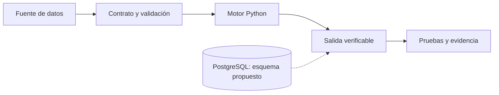
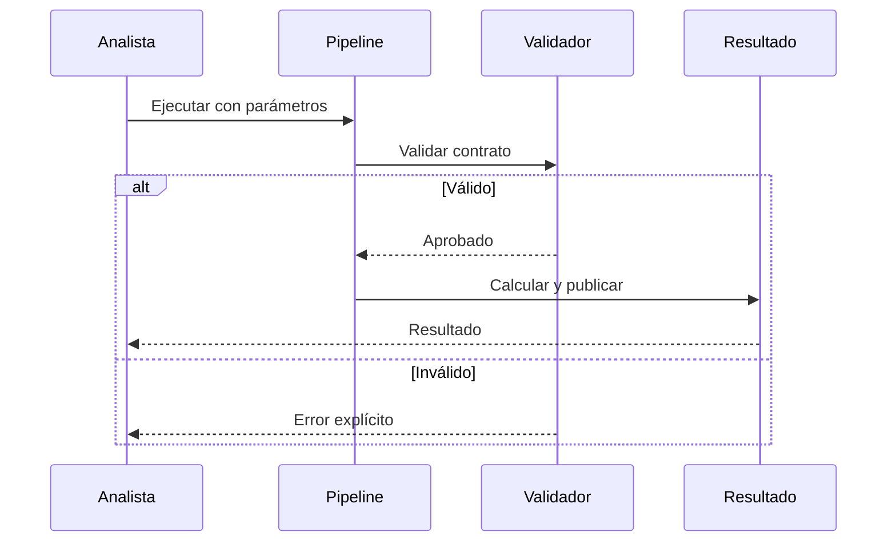

# Architecture Decision Record: Risk Data Platform

## Contexto y objetivo

Este proyecto cubre cortes D+1, deduplicación, conciliación, exactitud monetaria. Se implementa como prototipo reproducible, no como servicio desplegado.

## Diagrama de componentes



La línea discontinua representa una integración futura, no un servicio conectado.

## Diagrama de ejecución



## Invariantes

- Mismo input y configuración deben generar resultados reproducibles.
- Entradas inválidas deben fallar sin coerción silenciosa.
- El corte temporal debe permanecer explícito y trazable.
- Los errores deben ser observables y no ocultarse mediante valores por defecto.

## Pruebas

```bash
python3 -m unittest discover -s 05-ai-and-automation/data-engineering/01-risk-data-platform/tests -v
```

## Riesgos y límites

El SQL PostgreSQL es un contrato de persistencia propuesto; el motor Python no está integrado transaccionalmente con esa base. No hay todavía credenciales, control de acceso, monitoreo productivo ni SLA medido. Se requiere validar datos reales, volumen, costos, recuperación e integridad antes de desplegar.

## Próximas decisiones

1. Seleccionar backend y política de retención.
2. Incorporar pruebas de integración y migraciones.
3. Definir métricas de frescura, completitud y fallos.
4. Evaluar particionado, índices y observabilidad.
