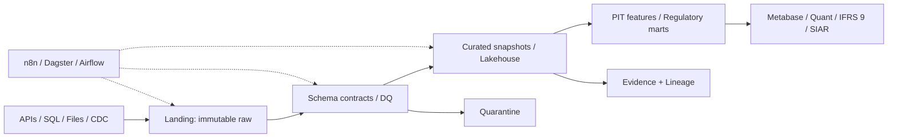

# Data Engineering — Reference Architecture v2

## Operating model

## Five-layer architecture

1. **Physical:** object storage, warehouse, snapshots, partitions, backups.
2. **Connectivity:** SQL, APIs, CDC, batch files; credentials in secret manager.
3. **Virtual:** logical contracts, source-to-target mapping, bitemporal semantics.
4. **Logical:** incremental transformations, idempotent orchestration, tests, evidence.
5. **User:** certified risk marts, Metabase, IFRS 9, quant engines, audit and Slack.

## Execution plan

**P0:** existing CSV MVP + shared reliability toolkit (implemented locally). **P1:** raw/curated immutable runs, manifests, snapshot-level atomic publish and idempotent run ledger. **P2:** source connectors, CDC, watermarks, event-time/availability-time modeling. **P3:** orchestration (n8n/Dagster), retries/backfill, observability, SLOs. **P4:** feature store, regulatory marts, macro vintages, CI/CD, RBAC, FinOps.

## Required production properties

- **Consistency:** published data and evidence share a single immutable run ID and atomic pointer.
- **Replay:** deterministic reruns and late-arrival correction policy.
- **Point-in-time:** no feature published after decision time can enter training.
- **Security:** least privilege, encrypted transport/storage, audit, no PII in Git.
- **Recovery:** run ledger, retries, quarantine, DLQ, incident runbooks.
- **Economics:** cost per million rows, p95 pipeline latency, SLO error budgets.
- **Regulatory:** reconciliation to ledger and signed-off model datasets.

These properties are **targets**; current local components do not provide full cloud production guarantees.
