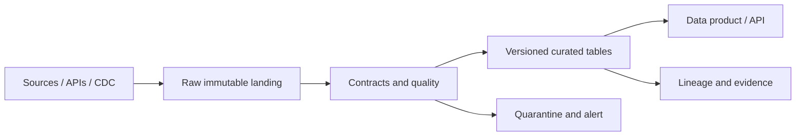

# Data Quality & Observability Control Plane

**Estado: arquitectura propuesta; no implementada.**

## Problema y decisión

Calidad, contratos, alertas y linaje de métricas de riesgo. Diseñar un contrato de servicio con usuarios, propietarios, frecuencia, SLA, riesgos de datos y decisión de negocio que habilita.

## Arquitectura técnica

Reglas declarativas, SLO, freshness, anomaly detection, evidence manifest..

## Contratos e invariantes

- Identidad de registros, orden de eventos y estrategia para duplicados.
- Semántica temporal: event time, availability time, ingestion time y cutoffs.
- Tipos, nulabilidad, precisión, compatibilidad de esquemas y política de evolución.
- Reconciliación origen-destino y manejo de correcciones retroactivas.
- Controles de acceso, retención, cifrado, privacidad y auditabilidad.

## Métodos de validación

Pruebas unitarias, contract testing, replay/backfill, fallos inyectados, cambios de esquema, reordenamiento, late arrivals, pruebas de carga y recuperación. Establecer benchmarks de costo y latencia. **KPIs:** Freshness, failed contracts, MTTD, MTTR, false alarms..

## Roadmap y entregables

**M1** diseño de datos y SLA; **M2** conector y raw zone; **M3** contratos y curated zone; **M4** observabilidad, reconciliación y seguridad; **M5** dashboard y runbook; **M6** CI/CD y stress operativo. Entregables: ADR, esquemas, pipeline, tests, manifiesto de evidencia, métricas y plan de incidentes.

## Riesgos y límites

Sin datasets reales y acceso a servicios no puede verificarse un SLA productivo. Separar demo sintética de certificación operacional. No almacenar PII ni credenciales en Git.
