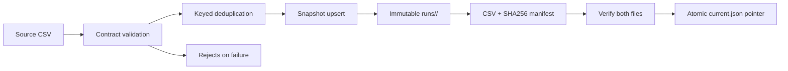

# Architecture decision record — Risk Data Platform MVP

## Layers
Physical (CSV snapshots / local filesystem) → Connectivity (CSV reader) → Virtual (schema and normalized rows) → Logical (deterministic upsert and reconciliation) → User (curated CSV + JSON manifest).

## Pipeline

## Data contract
- `loan_id`: nonempty string; `as_of_date`: ISO-8601 date; together form the immutable business key.
- `principal`: nonnegative finite decimal, two places; `days_past_due`: nonnegative integer.
- `status`: active, closed, default. Closed implies zero principal.
- `schema_version`: 1.0. Unknown columns and invalid values fail the batch.
- Repeated same-key records in one source must be identical. Later batches can update the same key.
- Historic snapshots are **not** summed to calculate a point-in-time outstanding balance; manifest sum is a sum across all stored snapshots, not a portfolio exposure metric.

## Reliability and limitations
- Deterministic ordering and SHA256 enable exact replay checks.
- Fail-closed on invalid records before publishing. Optional reject file includes line and reason.
- A run directory is completed before it is renamed into `runs/<run_id>/`. Its CSV hash is verified against its manifest before an atomic `current.json` pointer activates it. Readers resolve that pointer and therefore observe one run, never independently published files.
- This local implementation does not coordinate simultaneous writers. A shared deployment needs a writer lease / compare-and-swap pointer update supplied by its object store or database.
- This MVP does not provide CDC, database transactions, distributed storage, schema registry, IAM, encryption, scheduling, observability telemetry, SLA enforcement, data catalog or orchestration. These are subsequent milestones.
- Synthetic fixture only; no private or regulated data.
