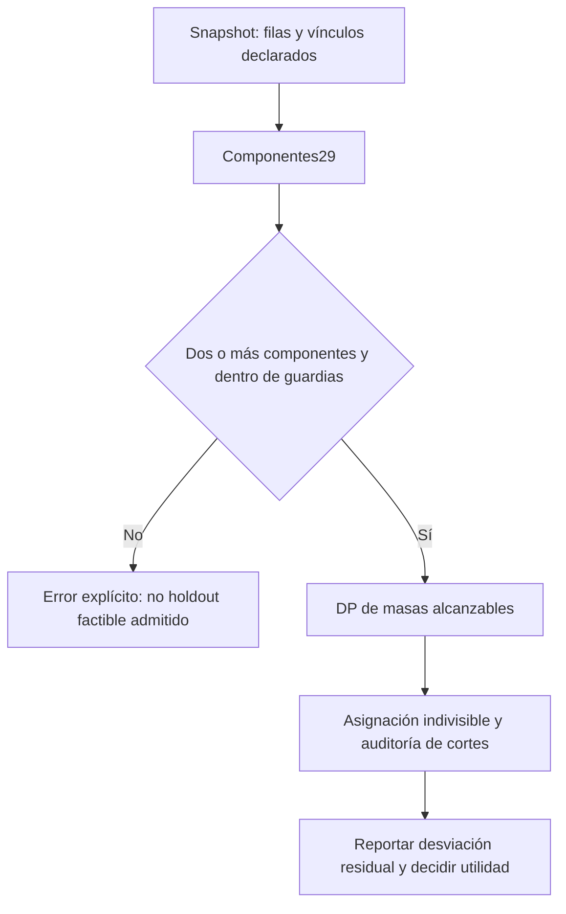

# Holdout por identidades vinculadas

MVP offline ejecutable del pilar02. Pregunta: ¿agrupar solo la clave primaria deja cadenas de identidad entre entrenamiento y test? Cierre transitivo de vínculos explícitos y holdout determinista por componentes; algoritmo conocido, integración incremental local. No entrena modelos ni infiere vínculos.

Desde esta carpeta: `bash run.sh` instala dependencias fijadas en .venv, ejecuta tests/lint/tipos, benchmark y notebook. Python3.12+ y acceso pip inicial requeridos. Reuso auditado: `PYTHON=/workspace/scratch/6c8b818bd733/ia28-env/bin/python SKIP_INSTALL=1 bash run.sh`.

Salidas: results/inputs.json, raw.csv, summary.json y leakage.svg; notebook.ipynb con outputs visibles. Notebook ejecutado mediante IPython secuencial en proceso; no kernel Jupyter independiente. Números deterministas: filas108/144 componentes cortados; clave primaria70/144; componente0/144. 12 seeds sobre el mismo corpus no son12 datasets independientes; sin intervalos inferenciales.

Todas políticas ordenan grupos por SHA256(seed:clave), reservan mitad de grupos. El baseline fila conserva18/36 train; primaria17–20/36; componente18/36 por grupos artificialmente iguales. Baselines difieren en unidad de partición: no son óptimos contra los que probar superioridad predictiva. Coste solo splitter incluyendo validación compartida; no incluye I/O/auditoría ni entrenamiento. Links se suministran antes del split, sin etiquetas. El uso de información del futuro para generarlos invalidaría una evaluación temporal.

Madurez local: prototipo experimental ejecutado, no validado en datos reales ni operacional; no se equipara S2 a M2. Sin cambios en shared, contratos ni aplicaciones riesgo. Ver informe.md (14 puntos) y referencias.bib. Cobertura de líneas no medida; no C++.

## Extensión acumulativa30: tamaños desiguales

El negativo explícito29 (componentes iguales) se aborda en la misma línea. `bash run_balancing.sh` instala el entorno fijado, ejecuta todos los tests29+30, lint/tipos,50 comparaciones sintéticas+6 mediciones de escala y notebook_balancing.ipynb (6celdas ejecutadas IPython en proceso). No modifica las salidas29. Derivación y unidades en derivacion30.md; matriz prior_art30.md, research-log.md y roadmap.md. Código src/balancing.py aplica DP subset-sum clásica con guardias; no es una nueva técnica ML.

Resultados:20/25 mejoras,5 empates,0 empeoramientos;0 cortes para ambas políticas. Desviación media3.5067→2.0133 filas. Negativo gigante:13.5 filas irreducibles. Experimentos sintéticos sin labels; no AUC ni escalabilidad industrial. La selección basada en tamaños usa solo metadata del snapshot; no resolver temporalidad ni calidad de vínculos. Madurez local experimental ejecutada, no validada/operacional. Ver informe_balancing30.md y results/balancing30/.

La última decisión es humana: el código no acepta automáticamente un split útil por tener0 cortes.

## Extensión31: auditar el grafo, además del split

`bash run_graph_audit.sh` instala y reproduce28 tests (21 regresión+7 nuevos), lint/tipos,144 escenarios/políticas registrados, escala del auditor28–28000 filas y notebook_graph_audit.ipynb ejecutado6 celdas con2 figuras visibles. Salidas `results/graph31/` CSV/JSON/PNG/logs. Reúso entorno: `PYTHON="$PWD/.venv/bin/python" SKIP_INSTALL=1 bash run_graph_audit.sh`.

Una segunda partición adjudicada completa permite distinguir fragmentación y sobre-unión. **Cero cortes declarados no garantiza cero fuga adjudicada**: en faltantes DP30 tiene0 cortes declarados y fuga verdadera12/12; en mixto logra balance perfecto pero expone28/28 filas. No es certificación de ML ni datos reales. El oráculo conoce verdad privilegiada y puede cortar el grafo declarado; no es baseline desplegable. Ver informe_graph31.md, derivacion31.md, prior_art31.md. No se cambian contratos/shared ni se elimina notebook anterior. Auditoría de ingeniería sobre la misma línea, sin claim de algoritmo nuevo.
