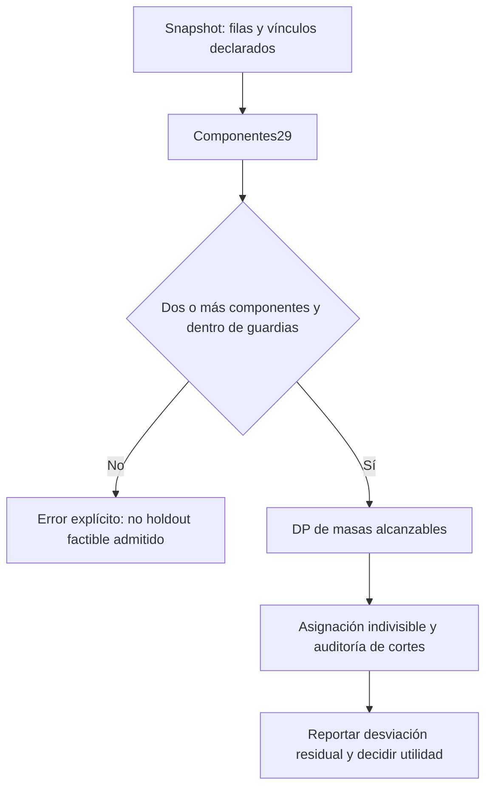
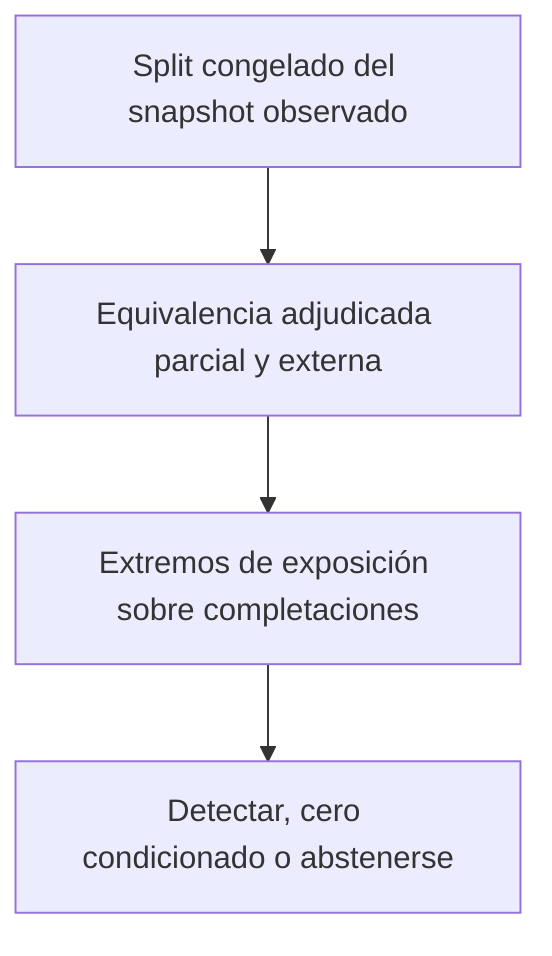
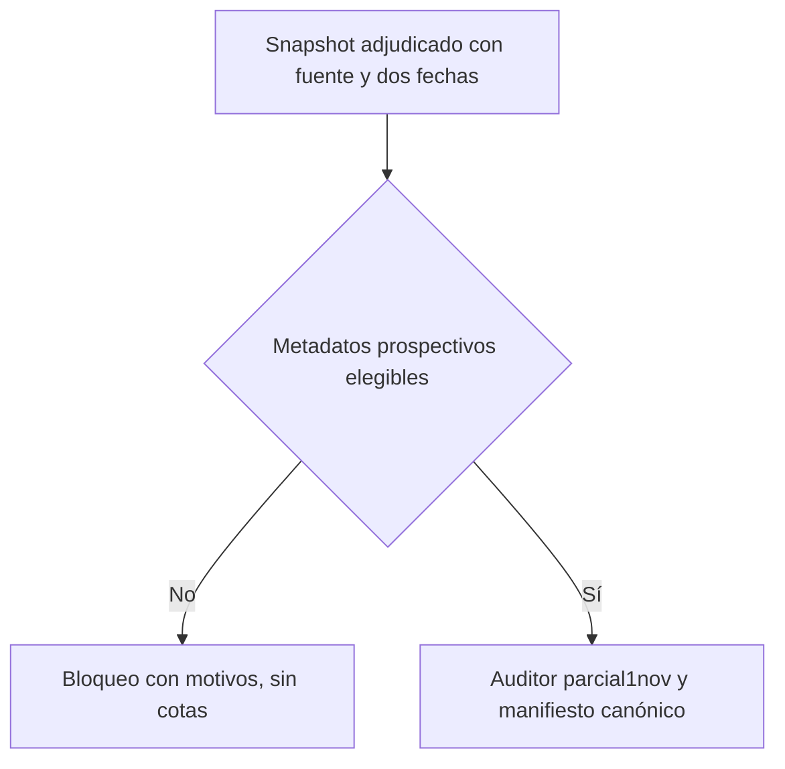

# Holdout por identidades vinculadas

MVP offline ejecutable del pilar02. Pregunta: ¿agrupar solo la clave primaria deja cadenas de identidad entre entrenamiento y test? Cierre transitivo de vínculos explícitos y holdout determinista por componentes; algoritmo conocido, integración incremental local. No entrena modelos ni infiere vínculos.

## Aplicación observada: entidades país en WDI

La edición controlada conserva grafos con vínculos y verdad conocida para estudiar cortes, sobre-unión y vínculo faltante. Como contraste con datos observados, `official_application.py` aplica las políticas de partición a 4.334 observaciones país–indicador del World Development Indicators (WDI), reutilizando el snapshot oficial ya versionado en el [proyecto MFA](../../../02-mathematics-statistics-and-quant/quantitative-methods/analisis-factorial-multiple-mfa/datos/manifest.json). El grano del experimento es un indicador de una economía; ISO3 es una identidad oficial conocida, no inferida.

En 100 semillas deterministas, el split aleatorio por fila separó observaciones de los **171 países elegibles en train y test en las 100 corridas**, afectando las 4.334 filas. La partición por componente de país produjo **cero países divididos y cero filas expuestas** en las 100 corridas. El resultado demuestra una propiedad de integridad de la partición sobre un conjunto real multiobservación; no mide AUC, fuga de etiquetas ni rendimiento predictivo, porque WDI aquí no incluye un target de modelo.

La decisión de uso es agrupar por la entidad que debe permanecer fuera del holdout antes de comparar modelos. Para evaluar solicitantes, empresas o grupos económicos todavía se requieren etiquetas y vínculos autorizados a ese grano. El snapshot WDI fue consultado para 2015–2022, pero la extracción heredada no conservó su timestamp ni vintage; sus hashes y alcance están en el [manifiesto del companion](results/official-wdi/manifest.json). El umbral de cobertura del 85% deja 171 de 217 economías y no elimina sesgo por faltantes.

- [Runner reproducible](official_application.py)
- [Resultados por semilla](results/official-wdi/seed_results.csv) · [Resumen](results/official-wdi/summary.json)
- [Figura de cortes por identidad](results/official-wdi/wdi-country-split-leakage.png)
- [Fuente WDI](https://databank.worldbank.org/source/world-development-indicators)

Desde la raíz de este proyecto, reproduce la aplicación con `python3 official_application.py` (Matplotlib opcional para la figura).

Desde esta carpeta: `bash run.sh` instala dependencias fijadas en .venv, ejecuta tests/lint/tipos, benchmark y notebook. Python3.12+ y acceso pip inicial requeridos. Reuso auditado: `PYTHON=/workspace/scratch/6c8b818bd733/ia28-env/bin/python SKIP_INSTALL=1 bash run.sh`.

Salidas: results/inputs.json, raw.csv, summary.json y leakage.svg; notebook.ipynb con outputs visibles. Notebook ejecutado mediante IPython secuencial en proceso; no kernel Jupyter independiente. Números deterministas: filas108/144 componentes cortados; clave primaria70/144; componente0/144. 12 seeds sobre el mismo corpus no son12 datasets independientes; sin intervalos inferenciales.

Todas políticas ordenan grupos por SHA256(seed:clave), reservan mitad de grupos. El baseline fila conserva18/36 train; primaria17–20/36; componente18/36 por grupos artificialmente iguales. Baselines difieren en unidad de partición: no son óptimos contra los que probar superioridad predictiva. Coste solo splitter incluyendo validación compartida; no incluye I/O/auditoría ni entrenamiento. Links se suministran antes del split, sin etiquetas. El uso de información del futuro para generarlos invalidaría una evaluación temporal.

Madurez local: prototipo experimental ejecutado, no validado en datos reales ni operacional; no se equipara S2 a M2. Sin cambios en shared, contratos ni aplicaciones riesgo. Ver informe.md (14 puntos) y referencias.bib. Cobertura de líneas no medida; no C++.

## Extensión acumulativa30: tamaños desiguales

El negativo explícito29 (componentes iguales) se aborda en la misma línea. `bash run_balancing.sh` instala el entorno fijado, ejecuta todos los tests29+30, lint/tipos,50 comparaciones sintéticas+6 mediciones de escala y notebook_balancing.ipynb (6celdas ejecutadas IPython en proceso). No modifica las salidas29. Derivación y unidades en derivacion30.md; matriz prior_art30.md, research-log.md y roadmap.md. Código src/balancing.py aplica DP subset-sum clásica con guardias; no es una nueva técnica ML.

Resultados:20/25 mejoras,5 empates,0 empeoramientos;0 cortes para ambas políticas. Desviación media3.5067→2.0133 filas. Negativo gigante:13.5 filas irreducibles. Experimentos sintéticos sin labels; no AUC ni escalabilidad industrial. La selección basada en tamaños usa solo metadata del snapshot; no resolver temporalidad ni calidad de vínculos. Madurez local experimental ejecutada, no validada/operacional. Ver informe_balancing30.md y results/balancing30/.

## Incremento3nov: revisiones completas y orden de dos tiempos

La siguiente precondición del mismo programa: el snapshot gate anterior no elegía entre varias revisiones. `bash run_temporal_revisions.sh` instala deps, corre la suite acumulada de 57 tests, Ruff y mypy, compara **1,080 consultas sintéticas × 6 políticas** con referencia de ordenamiento independiente, guarda 6,480 filas CSV y ejecuta `notebook_temporal1103.ipynb` de principio a fin con outputs y figura visibles. Los estados esperados se derivan del DGP sintético documentado, no son labels observados ni evidencia externa.

`src/temporal_revisions.py` selecciona la revisión completa de máxima disponibilidad al cutoff y luego verifica el intervalo de vigencia del hecho. Bajo el supuesto de reemplazo total evita que `validity_first` reactive una revisión antigua; en la grilla, la regla coincide con el oráculo (0/1080 falsos admitidos) y la ablación produce 510 falsos admitidos. `abstain_all` produce cero falsos admitidos a costa de 570 falsos rechazos. La figura cuenta ambos tipos de error. `results/temporal1103/` contiene CSV crudo comprimido como gzip, JSON/logs/PNG y coste sintético (corrida tras corregir empates: mediana77,527ns, p95 113,502ns, peak2,118B observado por tracemalloc por consulta; no throughput productivo).

Matriz `prior_art_temporal1103.md`, ecuación y límites `derivacion_temporal1103.md`, informe de14 puntos `informe_temporal1103.md`. Es auditoría/adaptación de ingeniería, no nueva teoría ni evidencia de leakage empírico. Supone historial full replacement; no autentica timestamps, no sirve a deltas, no cubre feature pipelines, no prueba generalización ni operación. Notebook ejecutado mediante IPython en proceso secuencial, no proceso kernel Jupyter aislado. Estado local candidato a PR; revisión independiente y CI remota separadas. Madurez: prototipo sintético ejecutado.

La última decisión es humana: el código no acepta automáticamente un split útil por tener0 cortes.

## Extensión31: auditar el grafo, además del split

`bash run_graph_audit.sh` instala y reproduce28 tests (21 regresión+7 nuevos), lint/tipos,144 escenarios/políticas registrados, escala del auditor28–28000 filas y notebook_graph_audit.ipynb ejecutado6 celdas con2 figuras visibles. Salidas `results/graph31/` CSV/JSON/PNG/logs. Reúso entorno: `PYTHON="$PWD/.venv/bin/python" SKIP_INSTALL=1 bash run_graph_audit.sh`.

Una segunda partición adjudicada completa permite distinguir fragmentación y sobre-unión. **Cero cortes declarados no garantiza cero fuga adjudicada**: en faltantes DP30 tiene0 cortes declarados y fuga verdadera12/12; en mixto logra balance perfecto pero expone28/28 filas. No es certificación de ML ni datos reales. El oráculo conoce verdad privilegiada y puede cortar el grafo declarado; no es baseline desplegable. Ver informe_graph31.md, derivacion31.md, prior_art31.md. No se cambian contratos/shared ni se elimina notebook anterior. Auditoría de ingeniería sobre la misma línea, sin claim de algoritmo nuevo.

## Incremento1nov: adjudicación parcial con cotas y abstención

El mismo programa acepta ahora equivalencia **completa entre filas adjudicadas de un subconjunto**, incluidas identidades distintas; no solo enlaces positivos incompletos. `bash run_partial_audit.sh` instala dependencias fijadas, ejecuta36 tests (28 regresión+8 nuevos), Ruff/tipos,480 comparaciones, escala del auditor y notebook_partial_audit.ipynb (6 celdas ejecutadas,2 figuras visibles). Datos sintéticos, sin AUC ni afirmación de independencia empírica. Salidas `results/partial1101/` CSV/JSON/PNG/logs; deriva fórmula y extremos alcanzables en derivacion1101.md, derivaciones también en notebook.

Bajo el contrato, calcula [L,H] de filas expuestas sobre todas las completaciones posibles;5508 configuraciones pequeñas verificadas contra enumeración independiente. A75% de cobertura, train-first obtiene anchura media15.625 filas frente21.395833 de baseline seguro, pero mantiene24/48 abstenciones. En otros regímenes no mejora la cota: resultado negativo conservado. Sin adjudicación devuelve[0,n], no extrapola; si la adjudicación es errónea las cotas pueden fallar. Madurez local experimental, no operación/validación empírica. Auditor31 permanece intacto y se recupera en el caso completo. Ver informe_partial1101.md, prior_art1101.md y roadmap.

## Incremento2nov: semántica y disponibilidad del snapshot

`bash run_snapshot_gate.sh` instala dependencias fijadas y reproduce46 tests (36 regresión+10 nuevos), Ruff/tipos,144 casos/6 políticas (864 CSV),12 mediciones de coste y notebook_snapshot_gate.ipynb ejecutado con6 celdas y2 figuras visibles. `src/snapshot_gate.py` añade un contrato local sobre adjudicación: fuente/esquema, equivalencia completa en subconjunto, effective_at/available_at≤cutoff con UTC; bloquea incompatibilidades **sin calcular cotas**. No modifica shared ni contratos de otros programas.

Resultados de conformidad sintética: gate y referencia as-of coinciden en144/144,8 admisiones elegibles y0 falsos admitidos/rechazados. Solo fecha efectiva admite4 snapshots no disponibles; solo semántica admite10 incompatibles. No es nuevo algoritmo ML ni estudio empírico. Un hash canónico vincula entradas/asignación/corte, y verify_manifest detecta modificaciones sin actualizar digest; **no autentica fuente ni fechas**. Negativo conservado: declaraciones falsas pueden pasar y dar cota0 frente8 filas expuestas reales.

Salida `results/snapshot1102/` CSV/JSON/PNG/manifests/logs, derivacion1102.md (fórmulas también en notebook), prior_art1102.md cinco fuentes verificadas e informe_snapshot1102.md14p. Notebook ejecutado IPython en proceso, no kernel aislado ni frontend Jupyter completo. Prototipo experimental, sin validación empírica/operación ni garantía de temporalidad del pipeline de features. El pilarML continúa para cerrar la precondición bloqueante1101; rotación y datos reales siguen pendientes.

