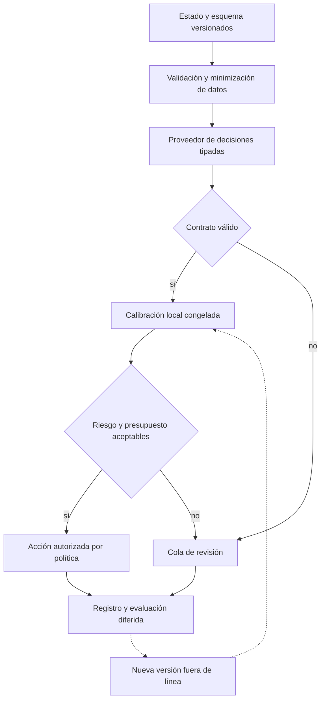

# Arquitectura 1 — Decisiones tipadas con abstención y costo

## Problema y uso

Una clasificación bien formada puede ser incorrecta. El sistema separa contrato de tipos, calibración local y acción económica. Sirve para enrutar tickets, verificar consistencia documental, ordenar candidatos de recuperación o priorizar revisiones. En crédito una probabilidad de contradicción no se convierte automáticamente en PD ni probabilidad de fraude.

## Capas y motores

| Capa | Entrada → salida | Invariante | Fallo y recuperación |
|---|---|---|---|
| 1. Ingesta | Estado, propósito, fecha → snapshot | Disponibilidad anterior a decisión | Estado incompleto deriva |
| 2. Contrato | Etiquetas/rúbrica → esquema versionado | Semántica estable y clases únicas | Nueva rúbrica exige nueva evaluación |
| 3. Inferencia | Estado → vector de probabilidades | Suma uno, finitud y versión | Timeout deriva; reintento acotado |
| 4. Calibración | Score → probabilidad local | Train/cal/test separados | Drift suspende uso del umbral |
| 5. Selectividad | Confianza → aceptar/derivar | Cota de error y soporte mínimo | Falta soporte significa abstención |
| 6. Decisión | Probabilidades y menú → acción | Costo y capacidad explícitos | No hay acción externa en este prototipo |
| 7. Evidencia | Entrada/hash/política → recibo | Versión y motivo recuperables | Persistir antes de efecto; replay explícito |

El motor de tipos ejecutado es `Decision`; el de selectividad es `select_threshold`; el económico es `choose_action`. El motor de inferencia comercial es una interfaz propuesta. Los notebooks usan scores sintéticos, no respuestas de Jev.

## Objetivos y ecuaciones

Para logits $z$ y temperatura positiva $T$, $p_T=\sigma(z/T)$. Estimar $T$ en una muestra independiente minimiza log loss, pero no garantiza calibración por subgrupo o bajo cambio de distribución.

$$\operatorname{NLL}=-\frac1n\sum_i[y_i\log p_i+(1-y_i)\log(1-p_i)].$$

En un grid fijo de $K$ umbrales, la cota usada es:

$$U_t=\min\{1,\widehat r_t+\sqrt{\log(K/\delta)/(2n_t)}\}.$$

Se maximiza cobertura sujeto a $U_t\le r_{max}$. Con calibración IID y reglas de aceptación fijas antes de las etiquetas, Hoeffding más unión permite elegir dentro del grid. No controla error condicional por grupo ni monitoreo infinito. La cota puede resultar demasiado conservadora.

$$C(a\mid p)=pL_a(1-q_a)+c_a+(1-p)f_a.$$

$L_a$: severidad; $q_a$: eficacia asumida; $c_a$: costo; $f_a$: fricción legítima, en la misma unidad. La comparación por caso no impone capacidad compartida: para ese caso reutilizar el MILP del dominio riesgo, sin duplicarlo.

## Integración y validación pendiente

1. Adaptar respuestas de Jev Choice/Score/Noul o ScaleDown Decisions al contrato neutral, conservando salida original y versión. No equiparar una escala ordinal con una probabilidad binaria.
2. Comparar con logit/boosting local y reglas sobre las mismas etiquetas y período.
3. Medir AP, Brier, log loss, riesgo-cobertura, errores por segmento y costo total; latencia p50/p95 y costo solo con telemetría real.
4. Evaluar errores correlacionados entre especialista y fallback. Un humano o LLM más costoso tampoco es un oráculo.
5. Revalidar después de cambiar modelo, idioma, rúbrica, población o etiquetas.

[Notebook con derivaciones y experimentos](notebook.ipynb). No hay promesa de reducción financiera real ni servicio desplegado.
