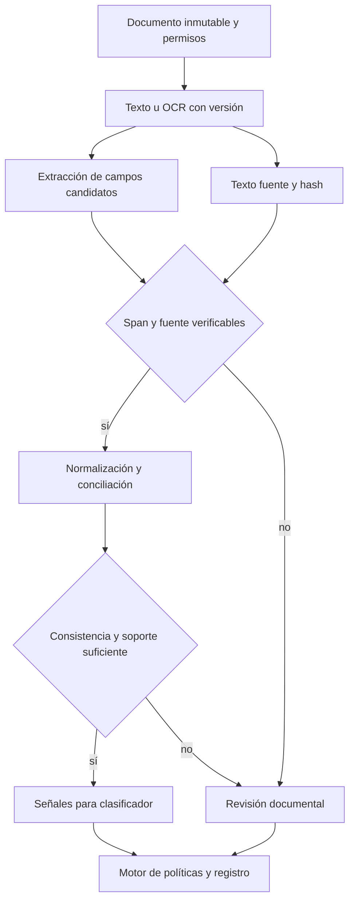

# Arquitectura 2 — Documentos con extracción y evidencia preservada

## Problema y uso

Una extracción puede devolver JSON válido y atribuir una cifra al concepto equivocado. Esta arquitectura conserva texto original, hash, offsets, unidad, periodicidad y contradicciones antes de clasificar. Sirve para soportes de ingreso, expedientes KYC y documentos técnicos; la aplicación financiera permanece en el dominio 03.

## Capas, contratos y recuperación

| Capa | Artefacto | Contrato | Recuperación |
|---|---|---|---|
| Captura | Bytes/document_id | Acceso, propósito, hash y versión | Duplicado por contenido no implica misma persona |
| Texto | Texto exacto y OCR versionado | No reemplazar original con resumen | OCR dudoso deriva |
| Extracción | Campo, valor y span | Offset explícito y documento original | Ambigüedad devuelve desconocido |
| Normalización | Monto, moneda, frecuencia | Conservar valor literal y regla | No inferir período ausente |
| Conciliación | Eventos únicos y contradicciones | Transferencia interna no es ingreso nuevo | Discrepancia no es fraude probado |
| Clasificación | Señales y contexto | Proveedor tipado + calibración local | Sin soporte se deriva |
| Auditoría | Evidencia, política, acción | Replay sobre snapshot | Cambios de fuente invalidan recibo |

`Evidence.verify` se ejecuta sobre texto UTF-8 cuyo hash se calcula antes de extracción. Los offsets son **índices de puntos de código Unicode de Python**, no bytes ni UTF-16. Un adaptador comercial debe convertirlos y comprobarlos. El hash no autentica al emisor, y coincidir con un span no acredita el significado del campo.

## Motores y fórmulas

El experimento usa un extractor literal determinístico como doble de prueba; no implementa OCR ni llama ScaleDown. Una integración futura podrá usar Extract para candidatos y Classify/Decisions o Jev para juicios de consistencia. Cada proveedor debe pasar el mismo corpus etiquetado.

$$v_j=s_d[a_j:b_j],\qquad h_d=\operatorname{SHA256}(\operatorname{UTF8}(s_d)).$$

La regla exige igualdad de valor y hash. Alterar el documento o copiar un valor de otra fuente produce rechazo. Un span verdadero con etiqueta equivocada continúa siendo un error semántico.

$$I_{mensual}=\sum_{e\in\mathcal E_{unicos}} monto_e\,factor(frecuencia_e)\,1[e\text{ es ingreso externo}].$$

La fórmula requiere identificar eventos y conceptos. Un saldo de cuenta no equivale a flujo salarial; un préstamo recibido tampoco es ingreso recurrente.

$$R=\frac{\#\text{ campos correctos retenidos}}{\#\text{ campos correctos esperados}},\quad
P=\frac{\#\text{ campos correctos retenidos}}{\#\text{ campos retenidos}}.$$

Estas métricas requieren etiquetas independientes. El notebook distingue retención de evidencia de exactitud semántica; no les da el mismo nombre.

## Evaluación y decisiones de arquitectura

- Comparar extracción directa, extracción con validación de spans y compresión antes de extracción. Eliminar una negación o una corrección puede mejorar longitud y empeorar la decisión.
- Conservar desconocidos, múltiples candidatos y fechas de disponibilidad. No convertir ausente en cero.
- Medir recuperación de campos, precisión, abstención, errores de moneda/período y costo de revisión; separar deterioro OCR y fallos de inferencia.
- Probar manipulación de texto, duplicados, Unicode, versiones y contradicciones. El corpus sintético no acredita seguridad integral.
- Reutilizar ELT incremental para persistencia y checkpoints durables para recuperación. No afirmar exactly-once de APIs externas por tener una transacción local.

[Notebook de evidencia, contradicciones y normalización](notebook.ipynb). No hay conexiones comerciales ni transmisión de documentos.
