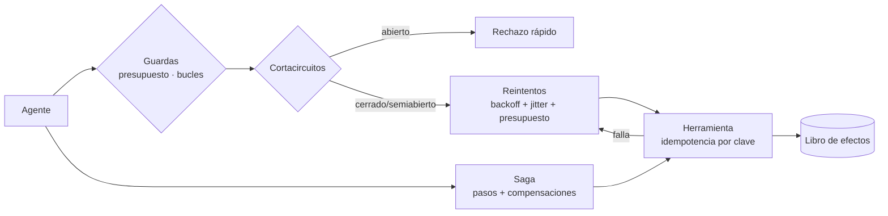

# Arquitectura

## Decisiones de diseño

- Reloj virtual y generadores aleatorios explícitos: toda corrida es determinista y se verifica contra la teoría.
- El servicio se modela por intervalos con capacidad finita; `collapse`=α>1 produce colapso por congestión (base de la falla metaestable).
- La clave de idempotencia se genera **una vez por operación lógica**, no por intento.
- Las compensaciones son reintentables y el atasco se mide explícitamente.

## Límites

- Modelo de capacidad por intervalos de 1 s; la dinámica real de colas es más rica.
- Fallos independientes; en producción hay correlación por dependencias comunes.
- Los agentes son guionados (sin LLM): se evalúa la infraestructura de control, no la calidad de las decisiones.
