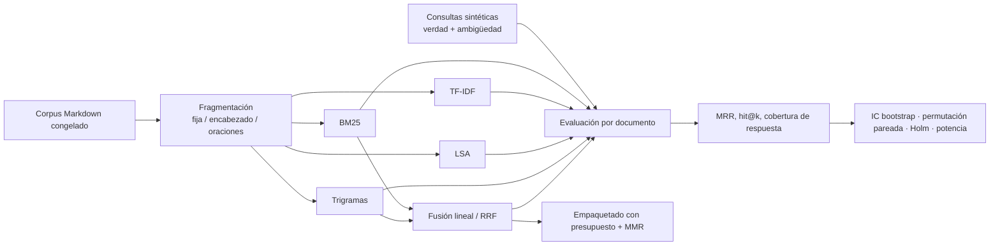

# Arquitectura

## Decisiones de diseño

- El corpus se **congela** en `datos/corpus_snapshot.json` para que los resultados no cambien cuando el repositorio crezca.
- La verdad es el documento de origen y se mide la **ambigüedad** de cada consulta (documentos que contienen todos sus términos).
- Las consultas usan palabras reales (no *stems*) y excluyen el título y la ruta del documento para evitar fugas.
- Todas las comparaciones usan los mismos fragmentos y consultas; las diferencias se prueban con permutación pareada y se corrigen por comparaciones múltiples.

## Límites

- Corpus pequeño y homogéneo; consultas sintéticas que favorecen el emparejamiento léxico.
- No se evalúan embeddings neuronales ni re-rankers (requieren modelos externos).
- La cobertura de la respuesta usa un hecho (número o término raro) como proxy, no evalúa la generación.
