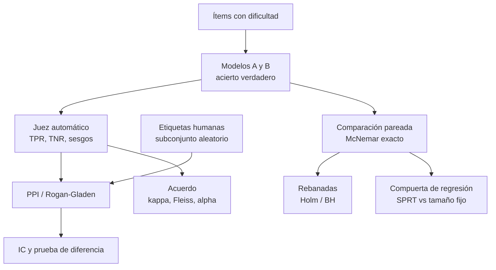

# Arquitectura

## Decisiones de diseño

- Todo método se contrasta con una verdad conocida (cobertura exacta, simulación Monte Carlo, fórmulas cerradas).
- Las etiquetas humanas son una muestra **aleatoria**; PPI mide y resta el sesgo del juez en lugar de suponerlo constante.
- Las pruebas pareadas operan sobre los ítems discordantes; el plan de muestra se hace con la tasa de discordancia.
- Las compuertas secuenciales exigen un tope máximo de muestra.

## Límites

- Modelos logísticos de un parámetro; los reales tienen perfiles multidimensionales.
- Jueces con error constante o dependiente de la verbosidad; los reales varían con la tarea y la versión.
- PPI supone etiquetas humanas correctas y representativas; el SPRT, discordancias independientes.
