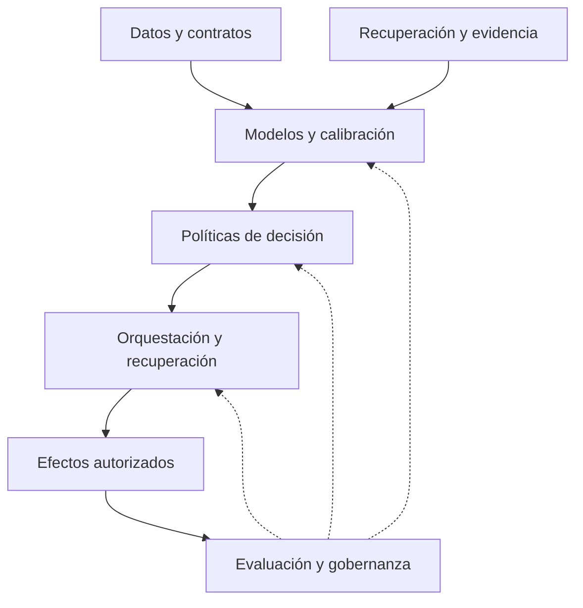

# Mapa de arquitectura de IA y sistemas computacionales

Fecha de corte: 23 de octubre de 2026. La organización sigue preguntas y responsabilidades; no se crea un pilar por proveedor. Los enlaces son a componentes reales y no implican que todas las conexiones estén implementadas.

| Responsabilidad | Propietario | Componentes existentes y conexión |
|---|---|---|
| Ingesta, disponibilidad y linaje | Data Engineering | [ELT incremental](data-engineering/data-pipeline-contracts-incremental-elt/) conserva contratos; [feature store](data-engineering/credit-feature-store/) es diseño |
| Aprendizaje e incertidumbre | Pilar 02 | [Conformal ponderado](02-machine-learning-engineering/02-conformal-risk-prediction/) estudia cobertura y utilidad bajo shift |
| Modelo y proveedor de decisiones | Pilar 03 | [Cascadas existentes](03-deep-learning-and-foundation-models/model-routing-cascade-economics/) y [arquitecturas tipadas](03-deep-learning-and-foundation-models/structured-decision-architectures/) |
| Agentes y decisiones de investigación | Pilar 04 | [Runtime de agentes](04-agentic-ai-and-multi-agent-systems/agent-runtime-reliability/) evalúa reintentos y fallos |
| Causalidad de acciones | Pilar 05 | [Off-policy evaluation](05-causal-ai-and-decision-intelligence/01-off-policy-policy-evaluation/) sigue como diseño; eficacia no se presume aprendida |
| Evidencia y recuperación | Pilar 06 | [RAG evaluado](06-knowledge-engineering-and-rag/rag-retrieval-evaluation/) y propuestas de auditoría |
| Flujo verificable | Pilar 07 | [Workflow verificable](07-intelligent-automation-and-process-mining/02-verifiable-workflow-orchestration/) es diseño |
| Medición, seguridad y versión | Pilar 08 | [Evaluación de jueces](08-ai-reliability-security-and-governance/llm-evaluation-judge-reliability/) aporta pruebas; gobernanza integral pendiente |
| Sistemas avanzados | Pilar 09 | [Diez diseños](09-advanced-ai-systems-engineering/) y kernel de benchmarks, no diez productos |
| Estado, reintentos y efectos | Pilar 10 | [Checkpoints SQLite](10-ai-orchestration-engineering/06-fault-tolerant-ai-execution-recovery/mvp-durable-checkpoints/) implementan recuperación local |

## Fronteras de integración

Los contratos entre componentes deben conservar request_id, fecha de disponibilidad, hash de fuente, modelo/rúbrica/política versionados, salida bruta, estado de validación y motivo de revisión. El prototipo nuevo verifica una parte de este contrato; no implementa un bus, IAM, servicio de inferencia ni almacén de auditoría integral.

La calibración y el umbral se congelan antes de test. La salida tipada no acredita semántica. La abstención se propaga como estado, sin convertirla en cero o normalidad. Una nueva rúbrica necesita nueva evaluación; una API compatible no hace intercambiables sus probabilidades.

## Relaciones con los otros dominios

IA desarrolla infraestructura y métodos. [Riesgo de fraude](../03-financial-risk/01-credit-risk/fraud-and-anomaly-research/) posee las etiquetas, la pérdida esperada, la capacidad de revisión y los criterios de uso crediticio. Economía posee identificación y explicaciones estructurales. Estrategia posee costos y decisiones de innovación. El motor MILP de riesgo no se copia dentro de IA.

Los resultados de hoy permanecen en la PR del ciclo mientras esté abierta. [Revisión e inventario](../reviews/2026-10-23-alignment/README.md) distinguen evidencia guardada, ejecución nueva y validación pendiente.

## Arquitecturas de aplicación: defensa de fraude con IA

La línea de riesgo posee [cuatro diseños por capas y archivos draw.io](../03-financial-risk/01-credit-risk/fraud-and-anomaly-research/ai-enabled-fraud-defense/diagrams/README.md). IA aporta aislamiento de extracción, contratos tipados, calibración, abstención y replay. Fraude posee tipologías, adjudicación y política económica; pagos conserva autorización de efectos; crédito conserva capacidad de pago. Los proveedores se evalúan como adaptadores especializados, sin crear una carpeta por marca ni duplicar el motor de pérdida. El nuevo notebook ejecutado estudia controles dependientes e indisponibilidad de proveedores, sin APIs comerciales.

## Aplicación al ciclo completo de crédito

El [mapa crediticio ampliado](../03-financial-risk/01-credit-risk/architecture/credit-lifecycle/README.md) ubica captura de señales, variables, modelos y workflow entre LOS, core, pagos, monitoreo y cobranza. Compara backend modular, arquitectura por eventos y core existente con decisión desacoplada. IA conserva contratos, estado, calibración y trazabilidad; el dueño del proceso conserva atribuciones, finalidad y autorización de efectos. Son diseños S1; no conectan a fuentes reales ni cambian el alcance de los experimentos previos.

## Estudios defensivos de la arquitectura de crédito

El [programa de diez proyectos](../03-financial-risk/01-credit-risk/architecture/credit-lifecycle/projects/README.md) enlaza orquestación, decisiones, linaje y modelos existentes con problemas específicos de crédito. Las [ocho capas defensivas adicionales](../03-financial-risk/01-credit-risk/architecture/credit-lifecycle/defense-layers/README.md) añaden evaluación de supuestos atacables, sondeo de interfaces y controles humanos sin duplicar runtimes o motores. Las 30 ideas y 40 escenarios nuevos están formulados; la ejecución de los experimentos y la integración siguen pendientes.
