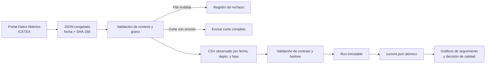

# Risk Data Platform — evidencia pública de cartera ICETEX

## Caso ejecutivo: publicar datos observados con corte auditable

Un área de riesgo necesita explicar qué observaciones sustentan un indicador y qué hacer cuando el origen publica cortes incompletos. Este caso usa datos oficiales de cartera educativa del ICETEX, por fecha, departamento y fase del crédito, y convierte la extracción pública en un snapshot verificable para seguimiento descriptivo. La unidad analítica es un grupo de créditos agregado; no se reconstruyen clientes ni contratos.

La edición congelada proviene de la ficha de [Comportamiento de Cartera y Crédito](https://www.datos.gov.co/Educaci-n/Comportamiento-de-Cartera-y-Cr-dito-/dugh-vkir), publicada por ICETEX. La fuente, actualizada el 15-oct-2026, entregó 1.308 filas. La validación detectó 68 filas que no conciliaban los conteos, todas para el corte 30-jun-2025. Aunque tres filas de ese corte sí conciliaban, se excluyó la fecha completa para no tratar una partición parcial como periodo comparable. La versión reproducible conserva el JSON original y su SHA-256; publica 1.237 filas en 18 cortes completos entre 2022-03-31 y 2026-09-30.

El recorrido registra datos crudos, valida la relación entre conteos y denominadores, deriva prevalencias agregadas de mora, conserva los rechazos, genera un CSV curado y publica el snapshot en un directorio inmutable. Un manifiesto documenta proveedor, dataset, fecha de actualización, hash de fuente y salida, fechas cubiertas, exclusiones y grano. Solo después de verificar el hash, un reemplazo atómico de `current.json` expone el run completo a sus consumidores.

La capacidad habilitada es decidir si un corte puede entrar al monitoreo, identificar una falla localizada de calidad y pedir aclaración al dueño de la fuente antes de usar el indicador. La proporción de créditos con mora mayor a 90 días es una prevalencia de stock; no es PD individual, migración a default ni ECL. El conjunto pertenece al ICETEX y no representa a los bancos vigilados por la SFC. No tiene vintages históricos de publicación, recuperaciones ni etiquetas contractuales; por eso no respalda calibración point-in-time ni validación IFRS 9. Es evidencia real de datos y de controles de publicación, no una aprobación de modelo o de uso regulatorio.

**Estado de la edición:** fuente pública observada; cortes incompletos excluidos de forma explícita. [One-pager ejecutivo (PDF)](../../../output/pdf/risk-data-platform-executive-brief.pdf).

## Arquitectura de alto nivel



## Evidencia y calidad observada

| Control | Evidencia de esta versión |
|---|---|
| Fuente y actualización | ICETEX, catálogo de datos públicos; actualizado 2026-10-15; extracción congelada 2026-11-10. |
| Cobertura final | 1.237 filas válidas; 18 fechas completas; 44 departamentos; etapas Estudios y Amortización. |
| Rechazo | 68 de 1.308 filas no concilian; todas en 2025-06-30. El corte completo, incluidas 3 filas válidas, quedó excluido. |
| Grano / llave | `fecha_corte × departamento × epoca_cartera`; duplicados de grano se rechazan. |
| Semántica | `creditos_mora_mayor_90d / creditos_total` es una prevalencia agregada a la fecha de corte, no una probabilidad de incumplimiento. |

La [tarjeta de fuente y datos congelados](../../../03-financial-risk/01-credit-risk/observed-data-proxies/data/README.md) conserva la atribución, hash, exclusiones, condiciones de uso y límites. El código de extracción/validación está en [observed_portfolio.py](../../../03-financial-risk/01-credit-risk/observed-data-proxies/src/observed_portfolio.py); la publicación inmutable está en [observed_icetex.py](src/observed_icetex.py).

## Decisiones de diseño

| Decisión | Alternativa | Motivo y coste |
|---|---|---|
| Excluir el corte completo si alguna fila no concilia | Publicar filas válidas del mismo corte | Evita una comparación temporal parcial. Se pierden tres filas válidas; queda documentado y reversible si el proveedor corrige la fuente. |
| Calcular ratios desde conteos y denominadores | Promediar porcentajes por departamento | Conserva la ponderación por número de créditos; requiere que los grupos publicados sean mutuamente excluyentes. |
| Conservar el indicador oficial como campo aparte | Sustituirlo por la razón derivada | Permite investigar diferencias de definición, escala o denominador sin confundir dos métricas. |
| Runs inmutables y puntero atómico | Reescribir el snapshot activo | Los consumidores resuelven un conjunto completo de CSV y manifiesto; archivos anteriores permanecen auditables. |
| Snapshot completo, no upsert contra una versión histórica | Fusionar y conservar claves ausentes | Evita mantener observaciones que el proveedor retiró; cada extracción representa la publicación vigente completa. |

## Gobierno y alineación normativa

| Marco | Decisión concreta | Límite de alineación |
|---|---|---|
| [BCBS 239](https://www.bis.org/publ/bcbs239.pdf) | Validación, lineage, fecha de corte, cuarentena y manifiesto apoyan exactitud y trazabilidad de datos agregados. | No acredita agregación de riesgo empresarial, oportunidad bajo estrés, gobierno ni cumplimiento de un banco. |
| [ISO 31000:2018](https://www.iso.org/standard/31000) | Una excepción de fuente se convierte en riesgo con dueño, evaluación y acción explícita. | No evalúa una organización ni implica certificación. |
| [COSO ERM](https://www.coso.org/enterprise-risk-management) | El corte excluido bloquea la decisión de comparar ese periodo hasta aclaración del proveedor. | No define apetito, responsables institucionales ni controles de negocio. |
| IFRS 9 | Los datos agregados pueden informar contexto de riesgo o escenarios, con una semántica distinta a ECL. | No permiten estimar PD, LGD, EAD, SICR, cash shortfalls ni provisiones de contratos. |

## Reproducir la edición observada

Desde la raíz del repositorio, con Python 3.13:

```bash
python3 05-artificial-intelligence-and-computational-systems/data-engineering/risk-data-platform/src/observed_icetex.py \
  --as-of 2026-11-10 \
  --source-json 03-financial-risk/01-credit-risk/observed-data-proxies/data/raw/icetex-dugh-vkir-2026-11-10.json \
  --source-last-updated 2026-10-15 \
  --snapshot-root 05-artificial-intelligence-and-computational-systems/data-engineering/risk-data-platform/releases/icetex-2026-11-10
```

El comando reproduce `releases/icetex-2026-11-10/runs/<run_id>/curated.csv`, comprueba el hash y actualiza `current.json`. Para extraer la versión actual del API, omitir `--source-json`; guardar cada extracción nueva con fecha y SHA-256 antes de actualizar los casos.

Los cuatro gráficos observados, su script y notas de lectura están en [observed-data-proxies/reports](../../../03-financial-risk/01-credit-risk/observed-data-proxies/reports). El conjunto congelado y su [manifest](../../../03-financial-risk/01-credit-risk/observed-data-proxies/data/processed/manifest.json) permanecen como evidencia de esta edición.

### Componente auxiliar de pruebas

`src/pipeline.py` conserva un contrato separado a nivel de crédito/fecha para pruebas deterministas de publicación. Su fixture en `examples/loan_snapshots.csv` no es la fuente de los resultados ejecutivos de esta edición ni se usa para producir los gráficos ICETEX.
