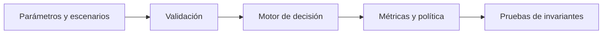

# Nota de diseño: 02-market-entry-game-theory

## Pregunta y criterio de decisión

El motor compara alternativas de decisión mediante un modelo explícito. Se diseñó para que sus supuestos puedan discutirse y las salidas puedan reproducirse con datos sintéticos antes de considerar una aplicación real.

## Formulación

```text
(i*,j*) es Nash si u1(i*,j*)>=u1(i,j*) y u2(i*,j*)>=u2(i*,j) para todas las desviaciones unilaterales.
```

## Arquitectura



La ejecución es local y no depende de servicios externos.

## Supuestos que importan

Juego simultáneo de información completa 2x2; no identifica equilibrios dinámicos, reputación ni aprendizaje.

## Estrategia de validación

Comprobar desigualdades de mejor respuesta, equilibrios múltiples y degeneraciones.

El directorio `tests/` contiene pruebas de referencia, pero todavía no sustituye una campaña de sensibilidad, una validación empírica ni un análisis de rendimiento.

## Lectura económica y estratégica

Las predicciones de entrada dependen de los incentivos de los incumbentes y de la estructura informativa.

## Riesgos metodológicos

- Los parámetros se introducen manualmente; no existe una calibración a datos reales.
- Los resultados cambian si los escenarios o las probabilidades están mal especificados.
- No hay optimización multiobjetivo, evaluación de incertidumbre paramétrica ni análisis causal identificado.
- No hay integración productiva ni controles de autorización para decisiones de negocio.

## Reproducir

```bash
python3 -m unittest discover -s 06-strategy-innovation-and-leadership/02-market-entry-game-theory/tests -v
```
