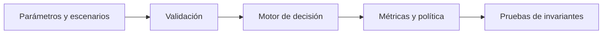

# Nota de diseño: 03-venture-portfolio-construction

## Pregunta y criterio de decisión

El motor compara alternativas de decisión mediante un modelo explícito. Se diseñó para que sus supuestos puedan discutirse y las salidas puedan reproducirse con datos sintéticos antes de considerar una aplicación real.

## Formulación

```text
P=Σ_i ticket_i·1{supervive_i}·exp(μ_i+σ_i(√ρ Z+√(1-ρ)ε_i))−Σ_i ticket_i
```

## Arquitectura



La ejecución es local y no depende de servicios externos.

## Supuestos que importan

Un único factor normal induce correlación positiva entre shocks de salida; los fallos se modelan independientes, por lo que no captura defaults correlacionados.

## Estrategia de validación

Sensibilidad a la cola lognormal, frecuencia de fallos, concentración y número de simulaciones.

El directorio `tests/` contiene pruebas de referencia, pero todavía no sustituye una campaña de sensibilidad, una validación empírica ni un análisis de rendimiento.

## Lectura económica y estratégica

La diversificación puede reducir concentración, pero no elimina shocks comunes ni sesgos de selección de startups.

## Riesgos metodológicos

- Los parámetros se introducen manualmente; no existe una calibración a datos reales.
- Los resultados cambian si los escenarios o las probabilidades están mal especificados.
- No hay optimización multiobjetivo, evaluación de incertidumbre paramétrica ni análisis causal identificado.
- No hay integración productiva ni controles de autorización para decisiones de negocio.

## Reproducir

```bash
python3 -m unittest discover -s 06-strategy-innovation-and-leadership/03-venture-portfolio-construction/tests -v
```
