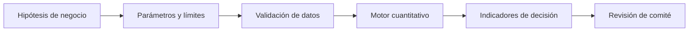

# Diseño técnico y lectura ejecutiva

## Modelo de decisión

```text
EVA_i=NOPAT_i−WACC_i·Capital_i; max Σ_i x_i EVA_i sujeto a Σ_i x_i Capital_i≤B.
```

## Diagrama



El último paso es una revisión humana, no una aprobación automática.

## Supuestos

Decisión binaria por unidad y beneficios independientes. El NOPAT esperado no se deriva de un modelo financiero completo.

## Controles y pruebas

Comparar EVA, ROIC y costo de capital; contrastar la selección ante cambios de WACC y presupuesto.

## Aplicación ejecutiva

Consejo/CEO: distribución del presupuesto de inversión y explicación del capital no asignado.

## Riesgos de interpretación

Los datos son sintéticos y no están calibrados a una empresa. No existe conexión con ERP, core bancario, CRM ni sistemas de gobierno. La utilidad de una política requiere estimación, validación y responsabilidad institucional. La optimización matemática no sustituye la discusión de restricciones legales, regulatorias y reputacionales.

## Reproducir

```bash
python3 -m unittest discover -s 06-strategy-innovation-and-leadership/06-enterprise-capital-allocation-roic/tests -v
```
