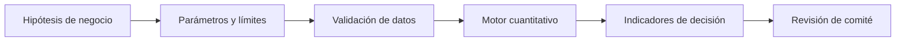

# Diseño técnico y lectura ejecutiva

## Modelo de decisión

```text
Utilización_i=Observado_i/Límite_i para métricas con cota superior; Límite_i/Observado_i para métricas con cota inferior.
```

## Diagrama



El último paso es una revisión humana, no una aprobación automática.

## Supuestos

Se evalúan límites positivos y métricas individuales. No hay correlación, agregación de capital ni análisis de escenarios en el motor.

## Controles y pruebas

Revisar bordes del límite, alertas previas, cero en denominador y escalamiento.

## Aplicación ejecutiva

CRO/Comité: distinguir advertencia de incumplimiento y formalizar responsables de respuesta.

## Riesgos de interpretación

Los datos son sintéticos y no están calibrados a una empresa. No existe conexión con ERP, core bancario, CRM ni sistemas de gobierno. La utilidad de una política requiere estimación, validación y responsabilidad institucional. La optimización matemática no sustituye la discusión de restricciones legales, regulatorias y reputacionales.

## Reproducir

```bash
python3 -m unittest discover -s 06-strategy-innovation-and-leadership/08-enterprise-risk-appetite-board-reporting/tests -v
```
