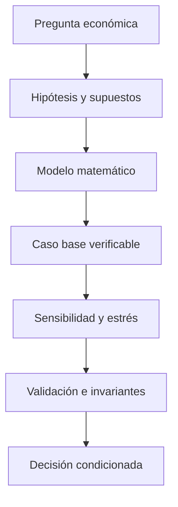

# Research extension — Unit economics

## Pregunta y tesis de trabajo

LTV/CAC depende de churn, margen, descuento y selección de clientes; una razón alta no garantiza liquidez.

## Protocolo de investigación

1. **Definir la decisión:** variable de control, horizonte, conjunto factible y función objetivo.
2. **Identificar supuestos:** parámetros observables, hipótesis de distribución y restricciones de información.
3. **Construir línea base:** cálculo manual y política simple para detectar errores de modelación.
4. **Ejecutar sensibilidad:** perturbaciones de parámetros y escenarios adversos; reportar decisiones que cambian.
5. **Validar resultados:** invariantes matemáticos, tests de regresión y análisis de estabilidad.
6. **Documentar límites:** diferencias entre simulación sintética y estimación empírica.

## Experimentos prioritarios

Sensibilidad de margen, CAC, churn y precio; punto de equilibrio.

## Criterio de evidencia

Los resultados de simulación deben indicar parámetros, unidades, horizonte, semilla cuando aplique y versión del modelo. Evitar afirmaciones de rentabilidad, cumplimiento regulatorio o efectividad empresarial sin validación independiente.

## Arquitectura de investigación

## Limitaciones y siguiente iteración

Este documento amplía el protocolo de validación del prototipo existente; no acredita que los experimentos se hayan ejecutado. La calibración con datos públicos, las pruebas de rendimiento y la evaluación ex post siguen pendientes.
