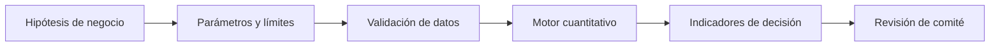

# Diseño técnico y lectura ejecutiva

## Modelo de decisión

```text
Caja_t=Caja_{t−1}+Ingresos−Egresos+AhorrosActivos_t−CostosImplementación_t.
```

## Diagrama



El último paso es una revisión humana, no una aprobación automática.

## Supuestos

Ahorros empiezan el mes de ejecución; no hay retardo, incertidumbre ni dependencias entre acciones.

## Controles y pruebas

Comparar trayectoria base y mitigada, primer incumplimiento, coste de acciones y umbral de caja.

## Aplicación ejecutiva

CEO/CRO: activar contingencias con anticipación, cuantificar coste y evaluar supervivencia.

## Riesgos de interpretación

Los datos son sintéticos y no están calibrados a una empresa. No existe conexión con ERP, core bancario, CRM ni sistemas de gobierno. La utilidad de una política requiere estimación, validación y responsabilidad institucional. La optimización matemática no sustituye la discusión de restricciones legales, regulatorias y reputacionales.

## Reproducir

```bash
python3 -m unittest discover -s 06-strategy-innovation-and-leadership/10-crisis-management-recovery-planning/tests -v
```
