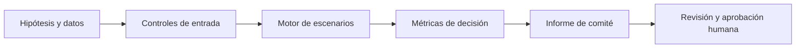

# Diseño matemático, operativo y de gobierno

## 1. Pregunta de decisión

Este modelo traduce una decisión de alta dirección en variables observables, restricciones explícitas y resultados verificables. La decisión final sigue correspondiendo a los órganos de gobierno.

## 2. Formulación

```text
max Σ_i x_i π_i sujeto a Σ_i x_i RWA_i ≤ Capital/RatioMin y 0≤x_i≤x_i,max.
```

## 3. Arquitectura



## 4. Supuestos y alcance

Las unidades de crecimiento son discretas y los factores RWA son exógenos. No se modelan buffers, colchones, riesgo de mercado ni apalancamiento.

## 5. Validación y estrés

Cambios de capital, riesgo ponderado, rentabilidad y ratio mínimo.

- Verificar casos de borde y consistencia aritmética.
- Comparar contra un caso manual independiente.
- Evaluar estabilidad ante perturbaciones de parámetros.
- Documentar explícitamente el origen y la fecha de cada dato antes de cualquier aplicación real.

## 6. Interpretación económica

El CRO/CFO puede evaluar qué líneas consumen capital y qué crecimiento cabe dentro de una restricción dada.

## 7. Límites y riesgo de modelo

No constituye cálculo normativo Basel III/SFC; el ratio es un supuesto de planificación.

Los datos de ejemplo son sintéticos. No hay integración con ERP, core bancario, sistemas de nómina ni plataformas de M&A. La estimación empírica, el control de cambios, la autorización y la monitorización de desempeño quedan fuera de esta primera versión.

## 8. Reproducibilidad

```bash
python3 -m unittest discover -s 06-strategy-innovation-and-leadership/12-balance-sheet-capital-management/tests -v
```
