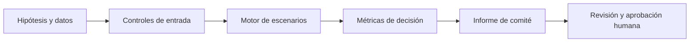

# Diseño matemático, operativo y de gobierno

## 1. Pregunta de decisión

Este modelo traduce una decisión de alta dirección en variables observables, restricciones explícitas y resultados verificables. La decisión final sigue correspondiendo a los órganos de gobierno.

## 2. Formulación

```text
NPV_adquisición = ValorStandalone − Precio + Σ_t(Sinergias_t−CostosIntegración_t)/(1+r)^t.
```

## 3. Arquitectura



## 4. Supuestos y alcance

Sinergias incrementales determinísticas por escenario, sin terminal value ni estructura de financiación.

## 5. Validación y estrés

Escenarios de sinergias fallidas, sobrecostos, tasa de descuento y precio de adquisición.

- Verificar casos de borde y consistencia aritmética.
- Comparar contra un caso manual independiente.
- Evaluar estabilidad ante perturbaciones de parámetros.
- Documentar explícitamente el origen y la fecha de cada dato antes de cualquier aplicación real.

## 6. Interpretación económica

La junta puede fijar precio máximo, estimar destrucción de valor y discutir riesgos de integración.

## 7. Límites y riesgo de modelo

No sustituye due diligence legal, financiera, tributaria ni análisis de competencia.

Los datos de ejemplo son sintéticos. No hay integración con ERP, core bancario, sistemas de nómina ni plataformas de M&A. La estimación empírica, el control de cambios, la autorización y la monitorización de desempeño quedan fuera de esta primera versión.

## 8. Reproducibilidad

```bash
python3 -m unittest discover -s 06-strategy-innovation-and-leadership/14-ma-strategic-synergies/tests -v
```
