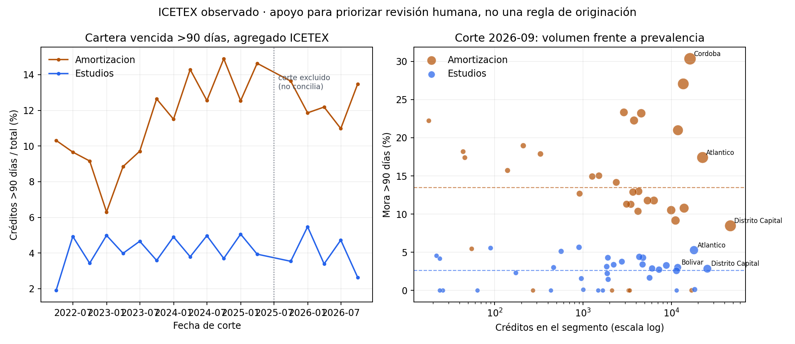

# Credit Portfolio Steering Leadership

**Rol objetivo:** Head of Credit Risk. **Estado:** S1: diseño de investigación e ingeniería, no motor ejecutable.

## Companion observado: priorización de revisión de cartera

### Decisión que apoya

En la reunión de cartera, el comité necesita decidir dónde iniciar una revisión humana de cobranza y servicio. `official_companion.py` ordena segmentos departamento × fase por volumen observado de créditos con mora mayor a 90 días y, por separado, destaca tasas de mora por encima del promedio ponderado de su fase. La salida es una agenda descriptiva de revisión; no asigna límites ni recomienda cambiar originación.

### Fuente, población y snapshot

La fuente es el conjunto agregado oficial [Comportamiento de Cartera y Crédito de ICETEX](https://www.datos.gov.co/Educaci-n/Comportamiento-de-Cartera-y-Cr-dito-/dugh-vkir), publicado por su Vicepresidencia de Crédito y Cobranza. El portal indicaba actualización 15-oct-2026; la extracción congelada es del 10-nov-2026. El grano es fecha de corte × departamento de residencia × fase (`ESTUDIOS` o `AMORTIZACION`).

El snapshot bruto se conserva en `data/icetex-dugh-vkir-2026-11-10.json` (SHA-256 `b91afdd83dd9738fb0dcd9606f67ecbdff2fd0da2af31138d9aeb68f83867a7e`). La tabla validada está en `data/icetex-delinquency-observed.csv` (SHA-256 `c856d4e8ac26b63347d18e722f5467a7f9421dce9b01ab79d3aad4ca5f13ffcf`), con el manifiesto de origen y el registro de rechazos en `data/`. Se retuvieron 1.237 filas en 18 cortes completos, 44 departamentos y dos fases. El corte 2025-06-30 se excluyó completo por errores de conciliación de conteos; el detalle está en `data/source-rejected-records.json`.

### Proxy, resultado y trade-off

El proxy de severidad es `créditos con mora >90 días / créditos totales`; el proxy de carga operativa es el conteo absoluto de créditos con mora >90 días. En el corte completo más reciente (30-sep-2026), para `AMORTIZACION` la prevalencia agregada fue 13,48% y para `ESTUDIOS` 2,63%.

Por volumen de casos >90 días, los cinco segmentos superiores son Córdoba, Distrito Capital, Atlántico, Sucre y Bolívar en `AMORTIZACION`; en `ESTUDIOS`, Atlántico, Distrito Capital, Bolívar, Sucre y Antioquia. Córdoba en amortización combina 4.936 créditos >90 días de 16.270 (30,34%); Distrito Capital aporta 3.949 casos, pero su tasa (8,47%) queda bajo el promedio de fase. Esto muestra por qué el volumen ayuda a ordenar carga de revisión y la tasa aporta un eje de severidad distinto. La lista top cinco por volumen no cambia al exigir denominadores mínimos de 100, 500 o 1.000 créditos.

La acción admisible es revisar primero estos segmentos y documentar causas, calidad de datos y capacidad operativa. No se combina volumen y tasa en un puntaje único: hacerlo impondría una preferencia no calibrada entre carga y severidad.



### Límites y gobierno

- ICETEX es cartera educativa; no representa MCA, crédito digital ni el sistema bancario. Es un proxy público para ejercitar una decisión de priorización ejecutiva, no validación de esas carteras.
- La prevalencia de un saldo agregado no es PD individual, probabilidad de transición, LGD, pérdida esperada ni evidencia de eficacia de cobranza. No usar para fijar límites, precios o elegibilidad.
- Los datos no contienen saldo expuesto, recuperaciones, rentabilidad, causa de mora ni efecto de gestión. El departamento es residencia del estudiante, no necesariamente una unidad de riesgo accionable.
- Las cifras son puntos de corte; no son vintages históricos de publicación. El flujo no estima causalidad, estabilidad de cohortes ni incertidumbre inferencial.
- Antes de asignar capacidad, validar los segmentos con responsables operativos y políticas; una decisión MCA/digital requiere datos autorizados a nivel de producto, cohorte, EAD, PD/LGD, costos y resultados de cobro.

### Reproducir

Desde esta carpeta, con Python 3, pandas, numpy y matplotlib:

```bash
pip install pandas numpy matplotlib
python3 official_companion.py
```

Se regeneran `reports/official_steering_results.json`, `reports/latest_cut_ranked.csv`, `reports/portfolio_phase_trend.csv` y la figura. El runner valida los hashes del snapshot y de la tabla derivada antes del cálculo.

La atribución solicitada para reutilizar los datos abiertos es: “Fuente: Portal de Datos Abiertos www.datos.gov.co”. Ver términos del [Portal Nacional de Datos Abiertos](https://herramientas.datos.gov.co/terminos).

## Diseño del motor pendiente

## Decisión y alcance
Asignar límites, originación y cobranza por cohortes y segmentos. Caso: MCA y crédito digital.

## Modelo matemático
max sum_s (ingreso_s - EL_s - fondeo_s - opex_s) x_s sujeto a EAD, concentración y presupuesto. Formalizar índices, unidades, horizonte, restricciones duras y política alternativa; comprobar existencia de solución y sensibilidad a no convexidad.

## Inferencia y riesgo de modelo
Transiciones Markov por vintage, EAD/PD/LGD, intervalos bootstrap y drift; evitar usar información posterior al corte. Separar estimación predictiva de afirmaciones causales, cuantificar incertidumbre y comparar contra una política simple.

## Métodos numéricos
Optimización restringida + simulación mensual de cosechas. Implementar una versión baseline determinista antes de algoritmos complejos; documentar convergencia, costo computacional, estabilidad y casos límite.

## Arquitectura
Datos versionados → validación y calidad → estimación → escenarios → optimizador → explicación de trade-offs → aprobación humana → monitoreo. Interfaces con contratos explícitos y auditoría de parámetros.

## Paquete de entrega S2
- `src/`: motor con interfaces tipadas y validación de entradas.
- `tests/`: invariantes, escenarios límite, reproducibilidad y regresión.
- `examples/`: caso sintético con verdad conocida, baseline y alternativas.
- `docs/`: teoría, calibración, seguridad, gobernanza, análisis de sensibilidad y nota para comité.
- CI reproducible; no declarar S2 hasta verificar ejecución.

## Criterios de decisión ejecutiva
Registrar responsable, capital o presupuesto comprometido, pérdidas adversas, trigger de revisión, riesgos residuales, evidencia disponible y supuestos que invalidarían la recomendación.
