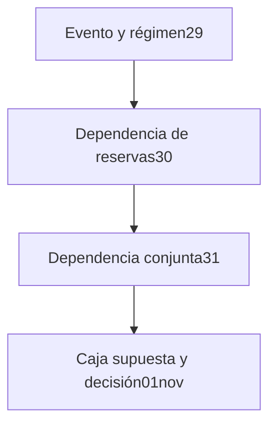

# De marginales puntuales a cajas supuestas

## Pregunta y notación
Se mantiene el evento del31 de octubre: quórum fijo3 y rol R obligatorio; tres principales presentes en normal y ausentes en shock. En normal el evento es R; en shock es $R\cap B_1\cap B_2$. $r$ es la marginal de R en **ambos** regímenes; $q_i$ la marginal de reserva i durante shock; $s$ el peso de shock. Son probabilidades adimensionales por sesión, no tasas anuales. Costo abstracto por opción autorizada del mismo par.

## Expresión original y limitación
Con dependencia conjunta arbitraria y marginales conocidas, las cotas puntuales clásicas especializadas en31 son
$$L=(1-s)r+s(r+q_1+q_2-2)_+,\qquad U=(1-s)r+s\min(r,q_1,q_2).$$
Su derivación por unión de complementos y construcción puntual de leyes extremas está en `derivacion-2026-10-31.md`. Fuente clásica: Nelsen (2006), no fórmula propia. Limitación: si las marginales o el peso difieren del punto, el certificado no los cubre.

## Conjunto propuesto y existencia
Suponemos caja rectangular no vacía
$$\Theta=[r_-,r_+]\times[q_{1-},q_{1+}]\times[q_{2-},q_{2+}]\times[s_-,s_+]\subset[0,1]^4.$$
No es una región de confianza estimada. Para cada punto hay alguna ley conjunta de las ocho masas; el producto independiente asegura factibilidad. Caja y simplex son compactos; objetivos continuos y restricciones cerradas aseguran extremos. Rectangular significa que todas las combinaciones de endpoints son admisibles. Si restricciones reales acoplan parámetros, esta caja puede sobreproteger y deja de ser sharp para ese conjunto menor.

## Derivación paso a paso
1. L es no decreciente en cada marginal: suma de $(1-s)r$ y una parte positiva no decreciente multiplicada por$s\ge0$. U también, porque el mínimo de tres coordenadas es no decreciente. Por tanto el mínimo usa marginales inferiores y el máximo superiores.
2. A marginales fijas, ambas son afines en$s$. Las pendientes son $(r+q_1+q_2-2)_+-r\le0$ y $\min(r,q_1,q_2)-r\le0$, respectivamente. La primera desigualdad usa$q_1+q_2\le2$ y$r\ge0$.
3. Así el mínimo de L usa$s_+$ y el máximo de U usa$s_-$:
$$L_{box}=(1-s_+)r_-+s_+(r_-+q_{1-}+q_{2-}-2)_+,$$
$$U_{box}=(1-s_-)r_++s_-\min(r_+,q_{1+},q_{2+}).$$
4. Esas esquinas pertenecen a la caja y admiten las leyes puntualmente extremas de31, de modo que son alcanzables para este evento. No se afirma una nueva cópula multivariada global ni un teorema original.

## LP independiente con intervalos
Para$p_{abc}\ge0$, $\sum p=1$, imponemos
$$r_-\le\sum ap_{abc}\le r_+,\quad q_{1-}\le\sum bp_{abc}\le q_{1+},\quad q_{2-}\le\sum cp_{abc}\le q_{2+}.$$
El objetivo es $\sum[(1-s)a+s\mathbf1_{a=b=c=1}]p_{abc}$. Se minimiza con$s=s_+$ y maximiza con$s=s_-$. **Incluye la asistencia normal de R dentro del objetivo**, por lo que el LP optimiza también su marginal y no agrega por fuera un punto incompatible. SciPy1.17/HiGHS usa desigualdades de intervalos, no los extremos calculados por la fórmula. Ambas alternativas reciben la misma información; precisión y costo se contrastan sin debilitar el baseline.

## Propiedades y límites
- Caja puntual recupera exactamente31. Cajas anidadas dan L no creciente y U no decreciente.
- $0\le L_{box}\le U_{box}\le r_+\le1$. Con todos presentes, ambas cotas son1. Si no hay shock, el intervalo es$[r_-,r_+]$.
- Se pierde precisión al relajar parámetros. No garantiza que el peor caso ocurra, solo que es admisible dentro del conjunto supuesto.
- La confianza estadística es otra capa: para intervalos aleatorios $C_i$ con cobertura individual$1-\alpha_i$, la unión de fallos da cobertura simultánea al menos$1-\sum_i\alpha_i$, sin independencia. La selección entre planes exige cobertura simultánea de todos los parámetros utilizados, no solo del plan seleccionado a posteriori. Sin datos ni procedimiento, hoy no se asigna ninguna$\alpha_i$ ni porcentaje de cobertura.

## Consecuencia verificable y decisión
Con$s\in[.19,.21]$, $r\in[.94,.96]$, $q_i\in[.78,.82]$, planB tiene$L_{box}=.79(.94)+.21(.50)=.8476$, inferior al punto31$.870$. Meta original$.85$ falla para alguna ley factible. PlanC, $q_i\in[.88,.92]$, tiene$.8896$ y cuesta4 frente a3 deB. Continuar la auditoría sintética; ajustar aC si se exige certificar la meta dentro de la caja; cerrar la recomendación del menú si ninguna opción cumple. No bajar quórum ni afirmar efectividad, legalidad o causalidad de gobierno.

## Flujo acumulativo editable

