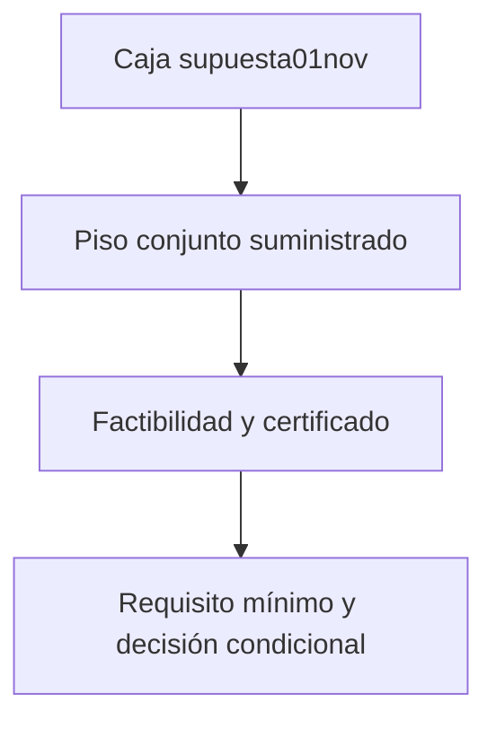

# ¿Qué restricción conjunta permitiría mantener una opción más barata?

## Pregunta acumulativa y unidades
Conservamos la caja del1 de noviembre, el menú A/B/C y el evento: quórum fijo3, R obligatorio; tres principales presentes en normal y ausentes en shock. En normal el evento es R; en shock es $R\cap B_1\cap B_2$. $r$ es la marginal de R en ambos regímenes, $q_i$ la marginal de reserva i durante shock, $s$ el peso del shock. Todas son probabilidades adimensionales por sesión. Costos abstractos por opción autorizada del mismo par. No votos favorables, legalidad o calidad de gobierno.

Pregunta: ¿qué piso de coasistencia de las reservas, si pudiera justificarse, bastaría para conservar B bajo incertidumbre? No existe una muestra de asistencia ni se afirma que hoy tengamos esa evidencia.

## Fórmula original y limitación
El1 de noviembre se obtuvo por monotonía y cotas clásicas
$$L_{box}=(1-s_+)r_-+s_+(r_-+q_{1-}+q_{2-}-2)_+.$$
La caja y la dependencia arbitraria pueden admitir leyes extremas incompatibles con información conjunta adicional. El roadmap pedía estudiar subconjuntos explícitos sin inventar cobertura estadística. Fuente clásica de cotas: Nelsen2006. La optimización de probabilidades sujeta a información de momentos tiene literatura primaria amplia, por ejemplo Bertsimas y Popescu2005; no reproducimos su algoritmo semidefinido general.

## Restricción propuesta y factibilidad
Sea$C=B_1\cap B_2$, $t=P(C\mid shock)$. Suministrar una restricción hipotética $t\ge\phi$ intersecta la clase anterior. Se exige
$$0\le\phi\le\min(q_{1+},q_{2+}).$$
Es condición necesaria porque C está contenido en ambas reservas. También es suficiente: pueden elevarse marginales dentro de sus intervalos hasta admitir al menos esa intersección. El producto independiente ya no es siempre testigo con el piso; la siguiente construcción prueba factibilidad sin asumir independencia.

La clase consta de ocho masas no negativas que suman1, desigualdades de marginales y $\sum bc\,p_{abc}\ge\phi$. Es compacta y no vacía cuando se satisface la condición; objetivos lineales alcanzan mínimos. Un piso fuera de rango se rechaza, no se transforma la infactibilidad en una certificación vacía.

## Derivación y alcanzabilidad paso a paso
1. Para el par, no negatividad de su tabla2×2 implica $t\ge q_1+q_2-1$. Con marginales intervalares y la nueva restricción:
$$t\ge t_*:=\max(0,\phi,q_{1-}+q_{2-}-1).$$
2. Considerar R y C como dos eventos da $P(R\cap C)\ge(r_-+t_*-1)_+$, sin independencia. Por probabilidad total y pendiente no positiva respecto a s:
$$L_\phi=(1-s_+)r_-+s_+(r_-+t_*-1)_+.$$
3. Para demostrar que no solo es una desigualdad válida, escoger$t=t_*$ y$q'_i=\max(q_{i-},t_*)$. Como$t_*\le\min(q_{1+},q_{2+})$, ambas marginales están en sus intervalos. La tabla del par es
$$p_{11}=t_*,\ p_{10}=q'_1-t_*,\ p_{01}=q'_2-t_*,\ p_{00}=1-q'_1-q'_2+t_*.$$
Las primeras tres masas son no negativas. Para la cuarta: si ninguna marginal se elevó, vale por$t_*\ge q_{1-}+q_{2-}-1$; si alguna se elevó a$t_*$, la otra no supera1. Así suma1 y respeta las restricciones.
4. Distribuir la masa$r_-$ de R primero en$C^c$ y solo el excedente en C alcanza$\max(0,r_-+t_*-1)$. En normal puede elegirse la misma marginal$r_-$, preservando el supuesto entre regímenes. La esquina$s_+$ está admitida. Por tanto Lφ es sharp para este evento y esta clase, no una nueva cópula global multivariada ni un teorema original.

## Propiedades conservadas y costo de restringir
Con$\phi=0$ se recupera exactamente01nov. Para pisos factibles crecientes, la clase es un subconjunto y el mínimo no puede bajar. Si$\phi\le\max(0,q_{1-}+q_{2-}-1)$, no hay ganancia: información redundante. $L_\phi\le r_-$, de modo que ningún piso compensa una meta mayor que la asistencia obligatoria en el peor parámetro. Se conserva dependencia arbitraria de R respecto al par. Se pierde protección frente a leyes excluidas por el piso: si el piso es falso, el certificado puede fallar.

## Requisito mínimo para una decisión
Si la caja ya cumple$\tau$, devolver0 evita reclamar información innecesaria. Si no cumple y$s_+>0$, despejar la desigualdad en la región activa da
$$\phi_{req}=1-r_-+\frac{\tau-(1-s_+)r_-}{s_+}.$$
Solo es factible si no supera$\min(q_{1+},q_{2+})$. Si$s_+=0$ y$r_-<\tau$, el par no puede reparar la decisión. Es un requisito sobre información futura, no una estimación obtenida de datos.

## LP competitivo e independiente
Optimiza ocho masas con suma1, seis desigualdades de marginales y una desigualdad de coasistencia. Objetivo $\sum[(1-s_+)a+s_+\mathbf1_{a=b=c=1}]p_{abc}$. El término normal contiene la marginal de R; no se agrega por fuera un punto incompatible. No usa el resultado cerrado para elegir masas. Ambas alternativas reciben exactamente caja y piso, y se mide solo el mínimo en ambas. Testigos guardados comprueban marginales y coasistencia además del objetivo.

## Consecuencia ejecutiva y límites
B conserva$r\in[.94,.96]$, $q_i\in[.78,.82]$, $s\in[.19,.21]$. Base de caja$.8476$. Con piso hipotético$.65$, $t_* =.65$ y$L_\phi=.79(.94)+.21(.59)=.8665$. Mínimo requerido para meta$.85$ es$4/7\approx.5714286$. Sin información adicional, C sigue siendo la opción certificada de costo4; con restricción válida suficiente, B cuesta3. La diferencia de una unidad es condicional, no ahorro observado o rentabilidad de un estudio.

Continuar con C bajo la caja; ajustar a B solo con restricción válida y vigente aceptada por responsables; cerrar el menú si no hay opción que certifique o rechazar inputs contradictorios. No rebajar quórum. No se atribuye cobertura95%, evidencia causal o normativa. Cualquier validación futura necesita población, régimen, permisos, calendario y cobertura simultánea documentados.

