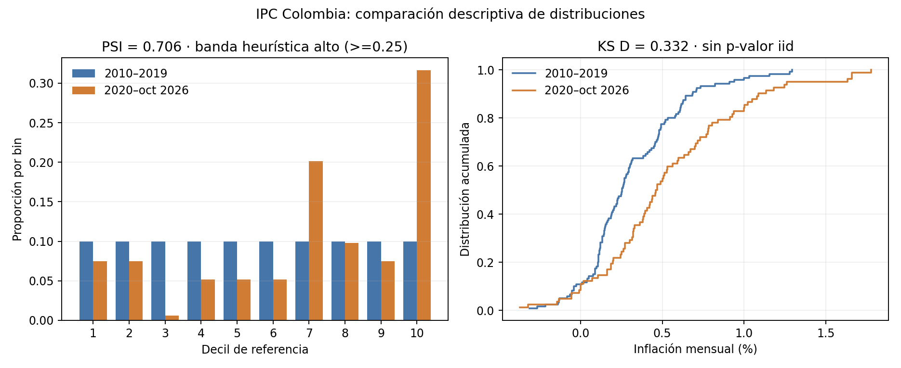

# Detección de drift de datos con PSI y KS

Monitoreo de cambios de distribución entre un período de referencia y uno actual: PSI y prueba de Kolmogorov-Smirnov por variable, con niveles de alerta y un resumen de variables a revisar.

## Dos capas: deriva controlada y comparación observada

`main.py` y el notebook conservan el laboratorio sintético con semilla fija, donde se conoce cómo cambian las distribuciones y se pueden mostrar alertas bajo escenarios controlados.

`official_companion.py` calcula una comparación observada y acotada: inflación mensual derivada del IPC total nacional colombiano, usando los índices mensuales publicados por DANE. La fuente es la serie de empalme 2003–2026 (octubre), con base diciembre de 2018 = 100; el anexo fue publicado el 9 de noviembre de 2026 ([anexo de índices DANE](https://www.dane.gov.co/files/operaciones/IPC/oct2026/anex-IPC-Indices-oct2026.xlsx); [ficha técnica](https://www.dane.gov.co/index.php/estadisticas-por-tema/precios-y-costos/indice-de-precios-al-consumidor-ipc/ipc-informacion-tecnica)). El snapshot se conserva en `data/dane-ipc-indices-oct2026.xlsx`; SHA-256: `4e8366bf2d03d4bdc15d14b1b21b12a6eec6c3695926abd503a430858ef74e2e`.

El proxy operacional es `100 × (IPC_t / IPC_(t-1) − 1)`, a grano mensual. Se comparan enero 2010–diciembre 2019 (120 meses) con enero 2020–octubre 2026 (82 meses). Los cortes están fijados antes de la comparación; el segundo periodo incluye varios regímenes macroeconómicos y no es un segmento de población de clientes.

El PSI fue **0,706** y KS D **0,332**. La media mensual pasó de 0,315% a 0,540% y la mediana de 0,253% a 0,464%. Para PSI se usaron deciles de referencia como bins fijos para ambas ventanas, eliminando cortes repetidos por empates y aplicando pseudocuenta de 0,5 por bin. Las bandas PSI <0,10, 0,10–0,25 y ≥0,25 se muestran solo como heurísticas de monitoreo; no son límites calibrados para IPC ni reglas de decisión.



### Interpretación y límites

- La salida describe un cambio en la distribución temporal de una serie macroeconómica nacional. No diagnostica drift de un modelo, degradación predictiva ni cambios en una cartera de clientes.
- Se reporta el estadístico D de KS, pero no p-valor: la dependencia serial mensual incumple la interpretación iid convencional del test de dos muestras.
- PSI depende de los cortes de referencia, el número de bins y la suavización; KS D depende de la comparación empírica. Ambos resumen una diferencia, no identifican su causa.
- Las ventanas tienen distinta longitud y abarcan regímenes distintos. La comparación no ajusta estacionalidad, autocorrelación, cambios metodológicos ni revisiones del índice. El IPC redondeado puede influir en empates y bins.
- Para convertirlo en monitoreo institucional harían falta población objetivo, ventanas y umbrales definidos con responsables, sensibilidad por subperiodo, tratamiento de revisiones y criterios de acción. Este ejercicio no valida esa operación.

`reports/official_distribution_results.json` conserva definición, hashes, fechas, tamaños muestrales, cálculos y límites; `reports/observed_monthly_inflation.csv` conserva la transformación derivada.

## Reproducir la comparación observada

Desde esta carpeta:

```bash
pip install numpy pandas scipy matplotlib openpyxl
python3 official_companion.py
```

## Reproducir el laboratorio sintético

## Cómo ejecutar

```bash
pip install numpy pandas scipy
python3 main.py
```

## Resultado de ejemplo

```text
PSI      KS  p_valor_KS alerta
variable                                      
ingreso      0.1004  0.1325      0.0000  AMBAR
edad         0.0015  0.0118      0.4894  VERDE
utilizacion  0.3672  0.2366      0.0000   ROJO
antiguedad   0.0023  0.0260      0.0023  VERDE
Variables a revisar: ['ingreso', 'utilizacion']
```

## Notebook

[`notebook.ipynb`](notebook.ipynb) desarrolla el tema de forma extensa: versión ingenua, diagnóstico, mejoras, robustez y **pruebas automáticas** (`assert`) que fallan el notebook si un hallazgo deja de cumplirse. Las cifras de sus conclusiones se calculan desde los datos. `main.py` es la versión corta del mismo tema.
