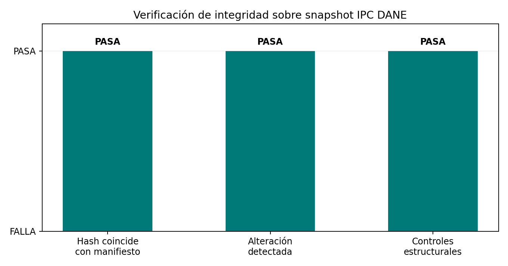

# Manifiesto de datos con SHA-256

Construcción de un manifiesto con hash SHA-256, tamaño y número de filas por archivo, y verificación de integridad posterior. Detecta una alteración de un archivo, un archivo faltante y uno nuevo no registrado.

## Capas del ejercicio

`main.py` mantiene el laboratorio **sintético** con semilla fija: construye un manifiesto y demuestra detección de archivo alterado, ausente y no registrado.

`official_companion.py` aplica la trazabilidad a un extracto de una fuente estadística oficial: IPC total nacional de DANE, índices mensuales de la serie empalmada 2003–2026 (octubre de 2026), base diciembre de 2018 = 100. El archivo `data/dane-ipc-monthly.csv` tiene grano de un índice mensual y 286 filas, desde 2003-01 hasta 2026-10. Se extrajo sin imputación ni reescalamiento del anexo [Índices de DANE](https://www.dane.gov.co/files/operaciones/IPC/oct2026/anex-IPC-Indices-oct2026.xlsx), publicado el 9 de noviembre de 2026 y enlazado desde la [página técnica del IPC](https://www.dane.gov.co/index.php/estadisticas-por-tema/precios-y-costos/indice-de-precios-al-consumidor-ipc/ipc-informacion-tecnica). SHA-256 del Excel de origen: `4e8366bf2d03d4bdc15d14b1b21b12a6eec6c3695926abd503a430858ef74e2e`; del extracto: `9dd8621dc3f979ea39d1728d1f35d682ea08746d089deea82d2db92cc00016bd`. CSV y outputs del corte septiembre siguen disponibles en `data/dane-ipc-monthly-sep2026.csv` y `reports/vintage-sep2026/`.

La edición observada verifica hash exacto del extracto, esquema, unicidad y continuidad mensual, completitud/positividad del índice y rango esperado; además altera una copia temporal para confirmar que el hash detecta un cambio. Los resultados actuales son **5/5 controles estructurales aprobados**, snapshot íntegro verificado y alteración detectada. La figura resume esos controles:



El manifiesto en `reports/official_manifest.json` registra tamaño, filas, hash del extracto, fuente y hash de origen; `reports/official_integrity_result.json` conserva la salida de la reproducción.

### Límites de interpretación

- SHA-256 prueba igualdad de bytes frente a un manifiesto confiable; no certifica que DANE esté libre de errores ni que el extracto sea apropiado para todo análisis.
- Los controles comprueban estructura y rangos esperados de esta fotografía; no comparan cada cifra contra una segunda publicación ni detectan revisiones futuras de la fuente.
- El Excel de origen se conserva en el proyecto ARIMA contiguo; el extracto CSV versionado en este proyecto permite reproducir la verificación sin depender de una descarga. Para reconstruirlo desde cero, desde la raíz del portafolio ejecutar `python3 02-mathematics-statistics-and-quant/quantitative-methods/arima-pronostico/official_application.py` y luego `cp 02-mathematics-statistics-and-quant/quantitative-methods/arima-pronostico/reports/dane_ipc_monthly_extracted.csv 06-strategy-innovation-and-leadership/data-leadership/manifiesto-de-datos-sha256/data/dane-ipc-monthly.csv`.

## Reproducir la aplicación observada

Desde esta carpeta:

```bash
pip install pandas matplotlib
python3 official_companion.py
```

## Reproducir el laboratorio controlado

## Cómo ejecutar

```bash
pip install numpy pandas
python3 main.py
```

## Resultado de ejemplo

```text
Manifiesto construido:
  macro.csv: f6f26102e85fd2d0... 5871 bytes, 100 filas
  precios.csv: 19ea8856ff574cee... 5893 bytes, 100 filas
  tasas.csv: b856210406e7eadb... 5878 bytes, 100 filas
Verificacion inicial: sin hallazgos
Verificacion tras cambios:
   FALTA: macro.csv
   ALTERADO: tasas.csv
   NO REGISTRADO: nuevo.csv
```

## Notebook

[`notebook.ipynb`](notebook.ipynb) desarrolla el tema de forma extensa: versión ingenua, diagnóstico, mejoras, robustez y **pruebas automáticas** (`assert`) que fallan el notebook si un hallazgo deja de cumplirse. Las cifras de sus conclusiones se calculan desde los datos. `main.py` es la versión corta del mismo tema.
