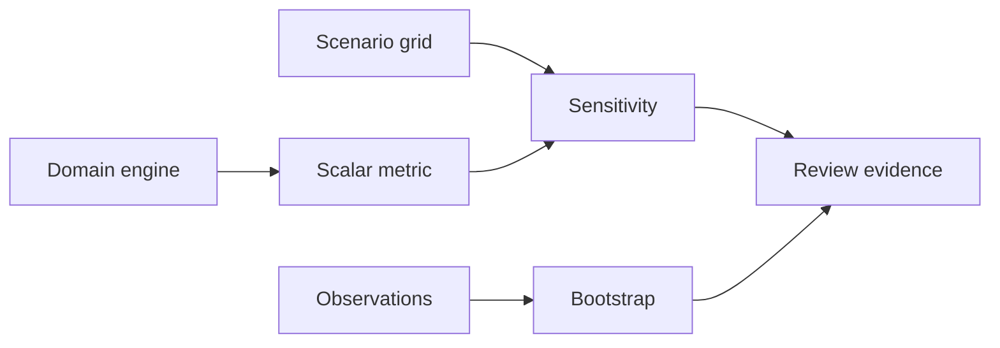

# Numerical validation toolkit

A small shared layer for the ten strategy and executive engines. The purpose is to make uncertainty explicit without replacing each project's domain-specific logic.

## Components

| Function | Purpose | Main assumption |
|---|---|---|
| `one_way_sensitivity` | Compare a baseline with controlled parameter perturbations | All other parameters held fixed |
| `weighted_scenario_summary` | Expected value, dispersion and downside probability | Exhaustive, mutually exclusive scenarios with calibrated probabilities |
| `bootstrap_mean_interval` | Percentile confidence interval for a mean | IID sampling; no time dependence or clustering |

## Why this matters

An optimizer can return a precise answer for uncertain inputs. The validation layer asks whether the recommended action changes when those inputs move, and how much uncertainty exists in an estimated mean.

### Mathematical definitions

For outcomes `x_s` and probabilities `p_s`:

```text
E[X] = Σ_s p_s x_s
Var(X) = Σ_s p_s (x_s - E[X])²
P(X < threshold) = Σ_s p_s 1{x_s < threshold}
```

For a one-way parameter grid `θ_k`:

```text
Δ_k = f(θ_k, θ_-k fixed) - f(θ_base)
```

The percentile bootstrap resamples observations with replacement, computes the mean of each resample and reports empirical quantiles. This is not appropriate for autocorrelated time series without block resampling.

## Architecture



## Reproduce

```bash
python3 -m unittest discover -s 06-strategy-innovation-and-leadership/shared_validation/tests -v
```

No external dependencies. No empirical datasets or production integrations are included.
