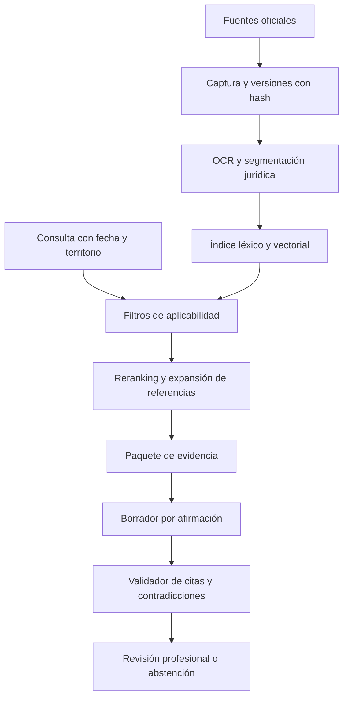
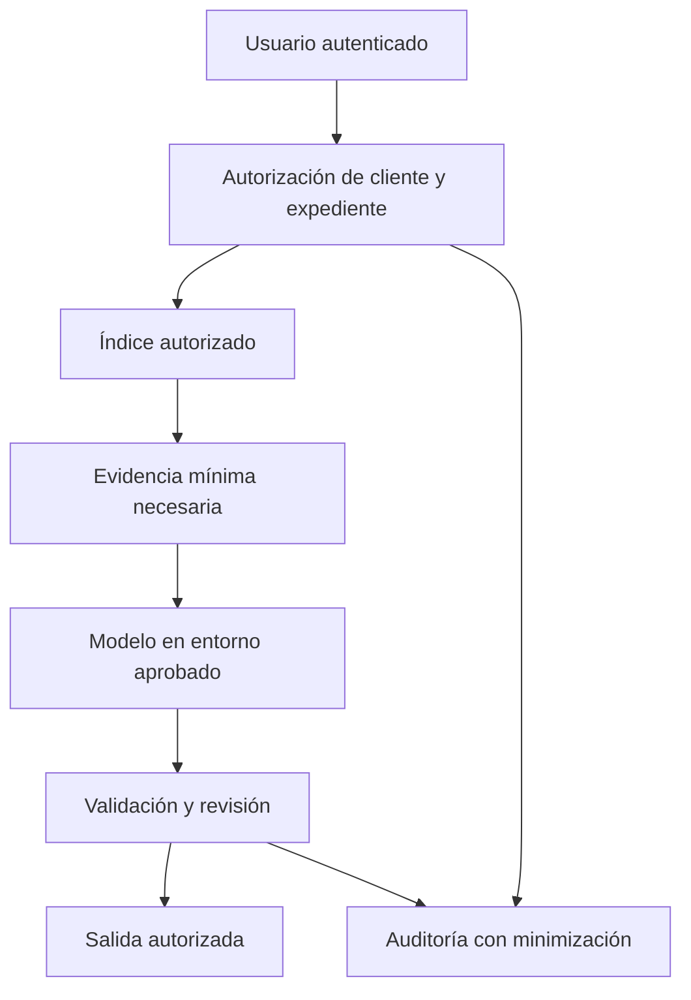

# Arquitecturas propuestas

## A. Investigación sobre corpus público

Segmentar por artículo, inciso y parágrafo, o por secciones de sentencia; conservar relaciones con encabezado, anexos y documento completo. Recuperación híbrida propuesta: BM25 + vectores, fusión por ranking y reranker evaluado en español jurídico. Medir cada mejora por ablación, sin asumir que GraphRAG mejora todas las consultas.

El grafo guarda relaciones `modifica`, `deroga`, `cita`, `condiciona` y `suspende` con fuente, fecha, alcance y revisión. Un enlace extraído automáticamente es candidato, no una determinación de vigencia o precedente.

## B. Intranet de expedientes

Aplicar permisos antes de retrieval y nuevamente al entregar; aislar cachés, logs y almacenamiento de embeddings. No enviar expedientes a APIs externas sin autorización y evaluación de tratamiento. Cifrado, gestión de claves, retención y borrado deben incluir índices y respaldos. Una fuente pública puede contener datos personales: público no equivale a uso ilimitado.

## C. Flujo de agentes con límites

| Rol | Entrada y salida | Permisos |
|---|---|---|
| Coordinador | Consulta → plan con hechos faltantes | Enruta; no decide el caso |
| Curador | Fuente → snapshot y metadatos | Ingestión permitida, sin ejecutar instrucciones del documento |
| Recuperador | Plan → pasajes y ranking | Lectura del corpus autorizado |
| Analista temporal | Versiones → aplicabilidad candidata | No declara vigencia sin evidencia |
| Analista jurisprudencial | Pasajes → tesis y distinciones | Separa ratio, obiter y salvamentos |
| Contradictor | Tesis → excepciones y evidencia adversa | No inventa contraejemplos documentales |
| Validador | Afirmación + pasaje → errores y soporte | Puede bloquear salida |
| Revisor humano | Paquete → aprobación o correcciones | Responsable de la decisión profesional |

Cada ejecución registra `run_id`, versión del corpus, modelo, herramientas, fuentes y decisiones. Presupuesto inicial de diseño: máximo dos rondas de revisión; si persiste contradicción material, escalar. No radicar escritos, consultar expedientes restringidos ni notificar terceros automáticamente. Las herramientas operan con listas permitidas y credenciales fuera del contexto del modelo.

Reutilizar infraestructura general de [IA](../../05-artificial-intelligence-and-computational-systems); mantener aquí contratos y evaluaciones específicos del dominio jurídico.
